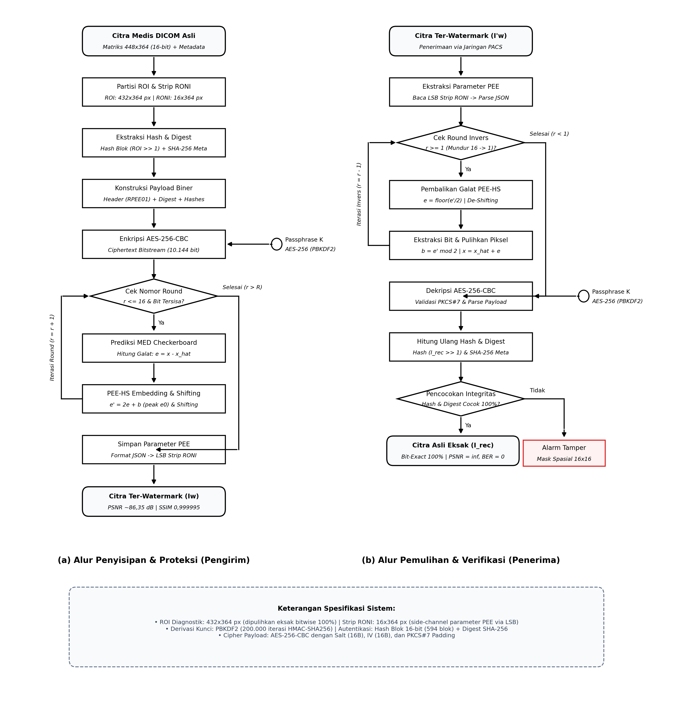

# Diagram Alur Lengkap Sistem Reversible DICOM Watermarking
**Topik:** Proteksi Integritas, Kerahasiaan, dan Pemulihan Eksak Citra Medis DICOM 16-Bit  
**Metode:** *Prediction Error Expansion - Histogram Shifting* (PEE-HS) Multiround + Enkripsi Kriptografis AES-256-CBC  
**Target Keberhasilan:** Pemulihan Wilayah Diagnostik *Bit-Exact* 100% ($\text{PSNR} = \infty, \text{BER} = 0, \text{SSIM} = 1,0$)  

---

## 1. Diagram Alur Makro (End-to-End Pipeline)

Diagram berikut menggambarkan perjalanan data secara utuh, mulai dari berkas DICOM asli dari modalitas rumah sakit (pengirim), proses proteksi *in-band*, transmisi melalui jaringan PACS, hingga proses verifikasi dan pemulihan sempurna oleh dokter radiologi (penerima).

```mermaid
flowchart TD
    %% Styling node
    classDef inputNode fill:#1E293B,stroke:#38BDF8,stroke-width:2px,color:#F8FAFC;
    classDef processNode fill:#0F172A,stroke:#818CF8,stroke-width:2px,color:#F8FAFC;
    classDef cryptoNode fill:#312E81,stroke:#C084FC,stroke-width:2px,color:#F8FAFC;
    classDef successNode fill:#064E3B,stroke:#34D399,stroke-width:2px,color:#F8FAFC;
    classDef fileNode fill:#1E1B4B,stroke:#F472B6,stroke-width:2px,color:#F8FAFC;

    subgraph Phase1 ["TAHAP 1: CITRA INPUT & PEMISAHAN REGION (PENGIRIM)"]
        A["Berkas DICOM Asli (*.dcm)<br>• Modalitas: MRI Brain (uint16)<br>• Matriks: 448 x 364 piksel<br>• Header: Metadata Pasien"]:::inputNode
        A --> B["Parsing DICOM (pydicom)"]:::processNode
        B --> C1["Wilayah Diagnostik / ROI<br>Baris 0 s.d. 431 (432 x 364 px)<br>Total 157.248 piksel"]:::processNode
        B --> C2["Strip Sintetis / RONI<br>16 Baris Terbawah (16 x 364 px)<br>Total 5.824 piksel"]:::processNode
        B --> C3["Metadata Kritis Pasien<br>(PatientID, StudyDate, UID, dll.)"]:::processNode
    end

    subgraph Phase2 ["TAHAP 2: PEMBENTUKAN & ENKRIPSI PAYLOAD (PENGIRIM)"]
        C1 --> D1["Bit Stabil Spasial (Piksel >> 1)<br>Grid Blok 16x16 (27 x 22 = 594 blok)"]:::processNode
        D1 --> D2["Hash Spasial Blok (SHA-256 Terpotong)<br>594 blok x 16-bit = 9.504 bit"]:::cryptoNode
        C3 --> D3["Intisari Metadata (SHA-256 Penuh)<br>32 byte = 256 bit"]:::cryptoNode
        D2 & D3 --> E["Perakitan Payload Biner Mentah<br>Header (80b) + Digest (256b) + Hashes (9.504b)<br>= 9.840 bit (1.230 byte)"]:::processNode
        E --> F["Enkripsi Kriptografi AES-256-CBC<br>• Kunci: Turunan PBKDF2 (200k iterasi)<br>• IV Acak (16B) & Salt Acak (16B)<br>• Padding PKCS#7 (+10B) -> 10.144 bit"]:::cryptoNode
    end

    subgraph Phase3 ["TAHAP 3: EMBEDDING PEE-HS & PEMBENTUKAN CITRA WATERMARK"]
        C1 --> G["Prediktor Checkerboard (MED)<br>Hitung Galat Prediksi: e = x - x_pred"]:::processNode
        F & G --> H["PEE-HS Multiround Embedding<br>Perluasan Galat: e' = 2e + b (pada e = e0)<br>Pergeseran Histogram: e' = e +/- e0 +/- 1<br>(Dinamis s.d. 16 Round)"]:::processNode
        H --> I1["Wilayah Diagnostik Ter-watermark<br>(Distorsi Sangat Halus, PSNR ~86 dB)"]:::processNode
        H --> I2["Parameter Side-Channel PEE<br>(e0, arah geser, n_bits per round)<br>Diringkas ke JSON Biner"]:::processNode
        I2 & C2 --> J["Penyisipan LSB Parameter<br>ke dalam 16 Baris Strip RONI"]:::processNode
        I1 & J --> K["Rekonstruksi Objek DICOM Terproteksi<br>Transfer Syntax Little-Endian Utuh"]:::fileNode
    end

    subgraph Phase4 ["TAHAP 4: TRANSMISI & PENYIMPANAN"]
        K --> L["Transmisi Jaringan / PACS Storage<br>(Citra Aman: In-Band Protection Melindungi Metadata & Piksel)"]:::fileNode
    end

    subgraph Phase5 ["TAHAP 5: VERIFIKASI & PEMULIHAN EKSAT (PENERIMA)"]
        L --> M["Penerimaan Berkas DICOM<br>oleh Terminal Radiologi Dokter"]:::inputNode
        M --> N["Ekstraksi Parameter Side-Channel<br>dari Bit LSB 16 Baris Strip RONI"]:::processNode
        N --> O["Deserialisasi JSON Parameter Round"]:::processNode
        O & M --> P["Pembalikan PEE-HS (Inverse Rounds 16 -> 1)<br>• Nilai Piksel Dipulihkan: e = floor(e' / 2)<br>• Ekstraksi Bitstream Ciphertext AES"]:::processNode
        P --> Q1["Wilayah Diagnostik Terekonstruksi<br>(Piksel Kembali 100% ke Nilai Awal)"]:::successNode
        P --> Q2["Ekstraksi Ciphertext AES-256"]:::cryptoNode
        Q2 --> R["Dekripsi AES-256-CBC (Passphrase Dokter)<br>Validasi PKCS#7 & Header RPEE01"]:::cryptoNode
        R --> S["Pemisahan Intisari Metadata & Hash Blok Asli"]:::processNode
        Q1 --> T1["Hitung Ulang Hash Blok (rec >> 1)"]:::processNode
        M --> T2["Hitung Ulang SHA-256 Metadata Header"]:::processNode
        S & T1 & T2 --> U{"Pencocokan Integritas<br>(Hash & Digest)?"}:::processNode
    end

    subgraph Phase6 ["TAHAP 6: HASIL AKHIR PEMULIHAN SEMPURNA"]
        U -->|100% Cocok Sempurna| V["STATUS: INTEGRITAS VALID & EKSAT<br>• Tidak Ada Manipulasi (Tamper = False)<br>• Wilayah Diagnostik 100% Bit-Exact Identik<br>• BER = 0, PSNR = Tak-Hingga, SSIM = 1,000000"]:::successNode
        V --> W["Simpan / Ekspor Citra DICOM Asli Utuh<br>Siap Didiagnosis Spesialis Radiologi"]:::successNode
        U -->|Ada Ketidakcocokan| X["STATUS: MANIPULASI TERDETEKSI<br>• Peringatan Keamanan Aktif<br>• Pembangkitan Mask Tamper Spasial (16x16)"]:::processNode
    end
```

---

## 2. Rincian Teknis Alur Pengirim (Sender / Protection Process)

Tahap ini dijalankan sebelum citra keluar dari modalitas scanner / terminal rumah sakit.

```mermaid
sequenceDiagram
    autonumber
    actor Pengirim as Operator / Radiografer
    participant DICOM as Modul DICOM (dicom.py)
    participant Crypto as Modul Kripto (aes.py & SHA-256)
    participant PEE as Modul Reversible (reversible.py)
    participant Disk as Penyimpanan Terproteksi

    Pengirim->>DICOM: Input Berkas Citra DICOM Asli (IM-0001-xxxx.dcm)
    DICOM->>DICOM: Baca pixel_array (448 x 364 uint16) & metadata pasien
    DICOM->>DICOM: Pisahkan ROI Diagnostik (432 x 364) & Strip RONI (16 x 364)
    
    rect rgb(20, 25, 45)
        note right of Crypto: Pembentukan Payload Autentikasi
        DICOM->>Crypto: Ekstraksi bit stabil (ROI >> 1) per grid blok 16x16 (594 blok)
        Crypto->>Crypto: Hitung SHA-256 per blok -> Ambil 16 bit pertama (9.504 bit)
        DICOM->>Crypto: Hitung SHA-256 dari metadata pasien (32 byte = 256 bit)
        Crypto->>Crypto: Rangkai Payload: MAGIC (RPEE01) + Config + Digest + Hashes (9.840 bit)
        Pengirim->>Crypto: Masukkan Passphrase Rahasia
        Crypto->>Crypto: PBKDF2 derivasi kunci + Salt acak + IV acak
        Crypto->>Crypto: Enkripsi AES-256-CBC + PKCS#7 Padding -> 10.144 bit ciphertext
    end

    rect rgb(15, 35, 30)
        note right of PEE: Reversible Watermarking (PEE-HS)
        Crypto->>PEE: Serahkan ciphertext bitstream (10.144 bit)
        loop Multi-Round (1 sampai 16 Round)
            PEE->>PEE: Hitung Median Edge Detector (MED) pada piksel target checkerboard
            PEE->>PEE: Bentuk histogram galat prediksi (e = x - x_hat)
            PEE->>PEE: Cari nilai puncak (peak e0)
            PEE->>PEE: Sisipkan bit payload: e' = 2e + b (pada e = e0)
            PEE->>PEE: Geser bin histogram di luar peak untuk mencegah tabrakan
            PEE->>PEE: Catat parameter round: {peak, direction, n_bits}
        end
        PEE->>PEE: Format parameter round menjadi JSON terkompresi
        PEE->>DICOM: Tulis parameter JSON via LSB pada 16 baris strip RONI terbawah
    end

    DICOM->>Disk: Simpan Citra Terproteksi (Watermarked DICOM)
    Disk-->>Pengirim: Status Sukses: PSNR 86,35 dB, SSIM 0,999995
```

---

## 3. Rincian Teknis Alur Penerima (Receiver / Exact Recovery Process)

Tahap ini dijalankan saat citra diterima oleh dokter spesialis radiologi di ruang baca radiologi.

```mermaid
sequenceDiagram
    autonumber
    actor Penerima as Dokter Radiologi
    participant DICOM as Modul DICOM (dicom.py)
    participant PEE as Modul Reversible (reversible.py)
    participant Crypto as Modul Kripto (aes.py & SHA-256)
    participant Viewer as DICOM Viewer / Layar Medis

    Penerima->>DICOM: Buka Berkas DICOM Terproteksi (*.dcm)
    DICOM->>DICOM: Ekstraksi LSB 16 baris strip RONI terbawah
    DICOM->>PEE: Deserialisasi JSON parameter dekompresi PEE

    rect rgb(15, 35, 30)
        note right of PEE: Pemulihan Piksel Lossless (Inverse PEE-HS)
        loop Multi-Round Terbalik (Round 16 mundur ke Round 1)
            PEE->>PEE: Hitung kembali prediksi MED piksel referensi
            PEE->>PEE: Ekstraksi bit ciphertext dari galat ganjil/genap
            PEE->>PEE: Kembalikan galat ke nilai asli: e = floor(e' / 2)
            PEE->>PEE: Geser balik histogram yang tergeser (de-shifting)
        end
        PEE-->>DICOM: Wilayah Diagnostik Pulih Bit-Exact 100%!
        PEE->>Crypto: Serahkan bitstream ciphertext terenkripsi
    end

    rect rgb(20, 25, 45)
        note right of Crypto: Verifikasi Integritas Kriptografis
        Penerima->>Crypto: Masukkan Passphrase Rahasia
        Crypto->>Crypto: Dekripsi AES-256-CBC & Validasi PKCS#7 Padding
        Crypto->>Crypto: Validasi Magic Byte 'RPEE01'
        Crypto->>Crypto: Pisahkan Digest Metadata Asli & Array Hash Blok Asli
        
        DICOM->>Crypto: Hitung ulang SHA-256 dari metadata header berkas saat ini
        DICOM->>Crypto: Hitung ulang 16-bit hash blok dari piksel terekonstruksi (rec >> 1)
        Crypto->>Crypto: Cocokkan Digest Metadata (SHA-256)
        Crypto->>Crypto: Cocokkan 594 Hash Blok Spasial satu per satu
    end

    alt Integritas 100% Cocok (Kondisi Normal)
        Crypto-->>Viewer: ALARM: INTEGRITAS VALID (Tamper = False)
        Viewer-->>Penerima: Tampilkan Citra Medis Asli (PSNR = Infinity, BER = 0)
    else Ditemukan Manipulasi / Serangan
        Crypto-->>Viewer: ALARM BAHAYA: CITRA TELAH DIMANIPULASI!
        Crypto-->>Viewer: Tandai Blok Spasial yang Tidak Cocok (Mask Tamper)
        Viewer-->>Penerima: Tampilkan Peta Merah Lokasi Manipulasi pada Citra
    end
```

---

## 4. Matriks Transformasi Data pada Setiap Titik Alur

Tabel berikut menunjukkan status data, dimensi, format tipe data, serta jaminan integritas pada setiap tahap aliran sistem:

| Tahap | Entitas Data | Dimensi / Ukuran | Format / Tipe | Status Integritas / Reversibilitas |
|---|---|---|---|---|
| **Input Awal** | Matriks Citra Asli | $448 \times 364$ piksel | `uint16` (12-bit riil, 0–1513) | Ground truth murni langsung dari scanner MRI |
| **Segmentasi** | Wilayah ROI Diagnostik | $432 \times 364$ piksel | `uint16` (157.248 piksel) | Dipisahkan untuk proteksi lossless PEE-HS |
| **Segmentasi** | Strip RONI Sintetis | $16 \times 364$ piksel | `uint16` (5.824 piksel) | Dicadangkan untuk penyimpan parameter kontrol |
| **Stabilisasi** | Matriks Bit Stabil | $432 \times 364$ piksel | `uint16` (`ROI >> 1`) | Mengabaikan bit LSB agar independen dari embedding |
| **Hashing** | Grid Hash Spasial | $27 \times 22 = 594$ blok | $594 \times 16\text{ bit} = 9.504\text{ bit}$ | Representasi integritas lokal per blok $16 \times 16$ |
| **Metadata** | Digest Header Pasien | 32 byte ($256\text{ bit}$) | Biner (SHA-256) | Mengikat PatientID, StudyUID, dan parameter klinis |
| **Payload Biner** | Plaintext Watermark | $1.230\text{ byte}$ ($9.840\text{ bit}$) | Biner (`RPEE01` + Digest + Hashes) | Struktur terformat mandiri (*self-contained*) |
| **Enkripsi** | Ciphertext Watermark | $1.268\text{ byte}$ ($10.144\text{ bit}$) | AES-256-CBC Ciphertext | Terenkripsi penuh (Kerahasiaan data terjamin) |
| **Embedding** | Citra Ter-watermark | $448 \times 364$ piksel | `uint16` (PSNR 86,35 dB) | Siap kirim via PACS, distorsi tak kasat mata |
| **Ekstraksi** | Ciphertext Terekstraksi | $10.144\text{ bit}$ | Bitstream biner | Diperoleh utuh dari pembalikan galat PEE |
| **Pemulihan** | Wilayah ROI Pulih | $432 \times 364$ piksel | `uint16` (157.248 piksel) | **100% Identik Biner (`np.array_equal` = True)** |
| **Hasil Akhir** | Citra Diagnostik Siap Baca | $448 \times 364$ piksel | Berkas DICOM standar | **Diagnostik bebas artifak, BER = 0, PSNR = $\infty$** |

---

## 5. Landasan Matematis Reversibilitas 100% (Bit-Exact)

Alasan mengapa proses ini dijamin **100% pulih tanpa merusak citra medis** didasarkan pada sifat komputasi *integer-to-integer reversible transform*:

### A. Tahap Penyisipan Galat (Forward Expansion):
Nilai piksel target $x$ diprediksi menggunakan nilai tetangga referensi $\hat{x}$ (operator MED), menghasilkan galat $e = x - \hat{x}$.
Untuk menyisipkan bit payload $b \in \{0, 1\}$ pada nilai puncak galat $e_0$:
$$e' = 2e + b$$
Piksel ter-watermark menjadi:
$$x' = \hat{x} + e' = \hat{x} + 2e + b$$

### B. Tahap Pemulihan Piksel & Ekstraksi Bit (Inverse Recovery):
Pada sisi penerima, karena piksel referensi **tidak pernah diubah sama sekali** selama proses embedding, nilai prediksi yang dihitung penerima **persis sama**: $\hat{x}_{\text{rec}} = \hat{x}$.
Penerima menghitung galat ter-watermark:
$$e' = x' - \hat{x}$$
Bit rahasia $b$ diekstrak menggunakan operasi modulo:
$$b = e' \pmod 2$$
Galat asli $e$ dipulihkan menggunakan pembagian bilangan bulat (*integer division*):
$$e = \left\lfloor \frac{e'}{2} \right\rfloor$$
Nilai piksel asli $x$ dipulihkan secara mutlak:
$$x = \hat{x} + e$$

Karena seluruh operasi matematika berjalan pada domain bilangan bulat murni tanpa pembulatan desimal (*no floating-point rounding errors*), **nilai piksel asli pada wilayah diagnostik kembali 100% eksak secara biner**.

---

## 6. Diagram Alur Ringkas Bergaya Publikasi Jurnal (Side-by-Side)

Berikut adalah diagram alur ringkas dua kolom paralel yang telah disesuaikan dengan format standar publikasi IEEE / Scopus / Sinta (berisi alur proteksi pengirim di kolom kiri dan alur pemulihan penerima di kolom kanan):

> **Berkas Gambar Siap Publikasi:**  
> • Format Vektor (PDF 300 DPI): [diagram_alur_jurnal.pdf](figures/diagram_alur_jurnal.pdf)  
> • Format Raster Cetak (PNG 300 DPI): [diagram_alur_jurnal.png](figures/diagram_alur_jurnal.png)  
> • Skrip Pembangkit Diagram: [generate_journal_flowchart.py](evaluation/generate_journal_flowchart.py)

---