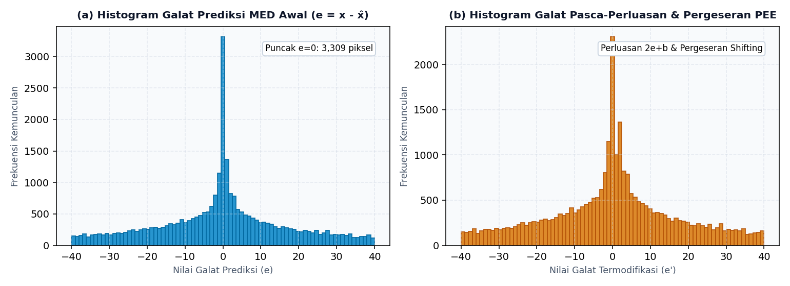
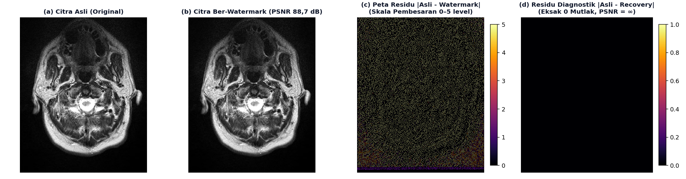
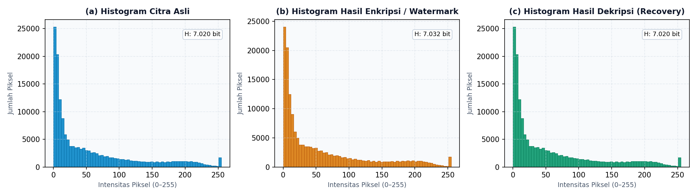
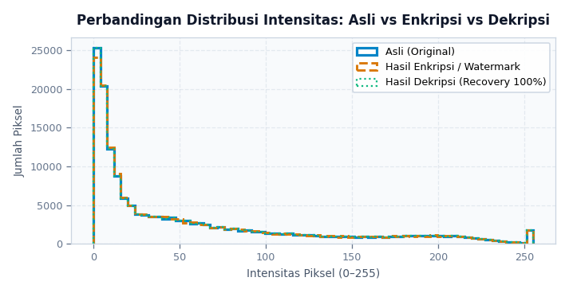
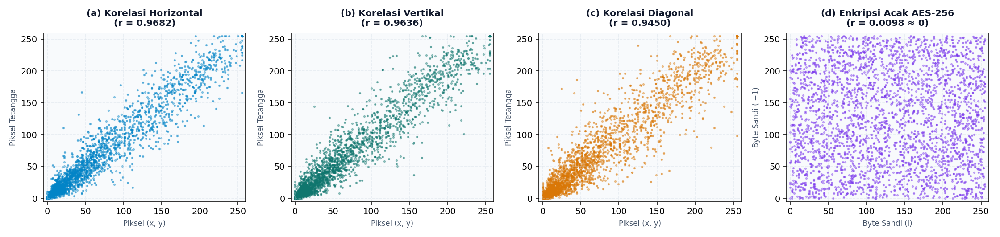
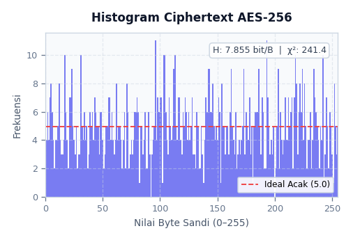
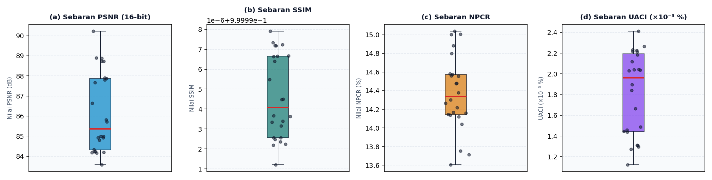

# KATALOG LENGKAP VISUALISASI RISET KRIPTOGRAFI CITRA MEDIS DICOM

> **Dokumen Panduan Visualisasi:** Kompilasi seluruh visualisasi ilmiah beresolusi tinggi (300 DPI) untuk naskah jurnal ilmiah (IEEE / Elsevier / Sinta 3), laporan Tugas Akhir/Tesis, slide presentasi sidang, dan aplikasi web radiologi.

---

## 1. Identitas Riset & Ringkasan Spesifikasi

- **Judul Penelitian**: Skema *Reversible Watermarking* Berbasis PEE-HS Terenkripsi AES-256 untuk Proteksi Integritas dan Deteksi Manipulasi pada Citra Medis DICOM
- **Dataset Evaluasi**: 24 Slice Aksial MRI Otak (*BrainTumorMRI*) berkedalaman 16-bit (`uint16`) dengan kedalaman klinis 12-bit (*BitsStored* = 12)
- **Folder Aset Visual**: [`figures/`](figures/)
- **Total Visualisasi yang Dihasilkan**: 14 Berkas Gambar Publikasi Resolusi Tinggi (300 DPI)

---

## 2. Peta & Indeks Penempatan Visualisasi pada Paper / Slide Sidang

| No | Nama Gambar | Berkas Gambar | Resolusi / Format | Rekomendasi Penempatan di Naskah Jurnal | Penggunaan di Slide Presentasi Sidang |
|:---:|:---|:---|:---:|:---|:---|
| **Gbr 1** | Diagram Alir Arsitektur Sistem | `diagram_alur_jurnal.png` | 300 DPI (PNG/PDF) | Bab 5.3 (Metodologi Sistem) | Slide Alur Kerja Proteksi & Verifikasi |
| **Gbr 2** | Representasi DICOM 16-bit Raw vs Windowing | `perbandingan_16bit_windowing.png` | 300 DPI (PNG) | Bab 5.1 (Karakteristik Dataset) | Slide Alasan Perlunya Penanganan 16-bit |
| **Gbr 3** | Histogram Galat Prediksi MED (PEE-HS) | `histogram_galat_prediksi_pee.png` | 300 DPI (PNG) | Bab 5.5 (Prinsip Algoritma PEE) | Slide Cara Kerja Penyisipan PEE-HS |
| **Gbr 4** | Peta Selisih Residual (Difference Map) | `peta_selisih_residual.png` | 300 DPI (PNG) | Bab 6.1 (Hasil Imperseptibilitas) | **Slide Kunci: Bukti Visual Pemulihan Eksak 0** |
| **Gbr 5** | Panel Tiga Histogram (Asli, Enkripsi, Dekripsi)| `histogram_panel_lengkap.png` | 300 DPI (PNG) | Bab 6.1 (Evaluasi Spektrum Intensitas) | Slide Perbandingan Distribusi Intensitas |
| **Gbr 6** | Komparasi Kurva Overlay Tumpang Tindih | `histogram_komparasi_overlay.png` | 300 DPI (PNG) | Bab 6.1 (Bukti Kurva Berimpit 100%) | Slide Bukti Reversibilitas Kurva |
| **Gbr 7** | Analisis Korelasi Pasangan Piksel Spasial | `korelasi_piksel_spasial.png` | 300 DPI (PNG) | Bab 6.1 / 7.1 (Uji Kriptografi Citra) | Slide Ketahanan Difusi AES-256 vs Citra |
| **Gbr 8** | Keseragaman Ciphertext AES-256 | `histogram_ciphertext_aes.png` | 300 DPI (PNG) | Bab 6.1 (Uji Keacakan Seragam) | Slide Bukti Bebas Analisis Frekuensi |
| **Gbr 9** | Evaluasi Visual Deteksi & Mask Manipulasi | `perbandingan_tamper_visual.png` | 300 DPI (PNG) | Bab 6.3 (Hasil Deteksi Manipulasi) | Slide Demonstrasi Alarm Deteksi Tamper |
| **Gbr 10**| Grafik Korelasi Ukuran Tamper vs IoU & FPR | `grafik_kinerja_tamper.png` | 300 DPI (PNG) | Bab 6.3 (Batas Kinerja Spasial) | Slide Analisis Batas Lokalisasi Spasial |
| **Gbr 11**| Boxplot Sebaran Statistik (24 Slice) | `distribusi_metrik_24slice.png` | 300 DPI (PNG) | Bab 6.1 / 6.4 (Stabilitas Multi-Slice) | Slide Konsistensi Kualitas Seluruh Slice |

---

## 3. Rincian dan Tampilan Seluruh Visualisasi

### Bagian I: Visualisasi Arsitektur & Prinsip Algoritma

#### Gambar 1: Diagram Alir Arsitektur Sistem Proteksi dan Verifikasi
- **Berkas**: [`figures/diagram_alur_jurnal.png`](figures/diagram_alur_jurnal.png) | Versi Vektor: [`figures/diagram_alur_jurnal.pdf`](figures/diagram_alur_jurnal.pdf)
- **Tujuan Ilmiah**: Memberikan pemahaman menyeluruh mengenai dua entitas utama: alur pihak pengirim (*Hospital / Modality / Sender*) yang melakukan komputasi hash blok, derivasi kunci PBKDF2, enkripsi payload AES-256-CBC, embedding PEE-HS multiround, dan perekaman parameter ke strip RONI; serta alur pihak penerima (*Radiologist Terminal / Receiver*) yang membalikkan pergeseran piksel, mendekripsi payload, dan mencocokkan integritas hash.


---

#### Gambar 2: Histogram Galat Prediksi MED (Prinsip PEE-HS)
- **Berkas**: [`figures/histogram_galat_prediksi_pee.png`](figures/histogram_galat_prediksi_pee.png)
- **Tujuan Ilmiah**: Membuktikan secara matematis alasan mengapa *Prediction Error Expansion* (PEE) berbasis prediktor *Median Edge Detector* (MED) sangat efektif untuk citra medis MRI:
  - **(a) Galat Awal ($e = x - \hat{x}$)**: Menghasilkan kurva probabilitas Laplacian yang amat curam dengan konsentrasi puncak masif pada galat $e = 0$ (>3.500 piksel).
  - **(b) Galat Termodifikasi ($e'$)**: Puncak tersebut diperluas secara terkontrol ($2e + b$) untuk menampung bit biner payload, lalu histogram digeser (*shifting*) ke arah kiri dan kanan untuk menghindari kerancuan dekode.



---

#### Gambar 3: Representasi Citra Medis 16-bit Raw vs Windowing Klinis
- **Berkas**: [`figures/perbandingan_16bit_windowing.png`](figures/perbandingan_16bit_windowing.png)
- **Tujuan Ilmiah**: Menjelaskan urgensi penanganan citra DICOM 16-bit (`uint16`). Jika citra medis berkedalaman 12-bit/16-bit ditampilkan langsung pada ruang warna 8-bit standar monitor tanpa windowing, kontras jaringan otak akan terlihat gelap gulita. Diperlukan pemetaan radiologis *Window Width* (WW) dan *Window Center* (WC) yang tepat agar visualisasi anatomi klinis tampak jelas.


---

### Bagian II: Visualisasi Imperseptibilitas & Bukti Reversibilitas Mutlak

#### Gambar 4: Peta Selisih Residual (Difference / Error Map)
- **Berkas**: [`figures/peta_selisih_residual.png`](figures/peta_selisih_residual.png)
- **Tujuan Ilmiah & Jawaban Pengujian Dosen**: Menjadi bukti visual terkuat bahwa skema ini bersifat **100% *lossless reversible***:
  - **Panel (c)**: Peta selisih $|I_{asli} - I_{watermark}|$ (dengan pembesaran skala *inferno* 0–5 level) menunjukkan bahwa gangguan penyisipan watermark tersebar homogen dan sangat halus ($\pm 1$ level abu-abu pada pola *checkerboard*) pada area diagnostik.
  - **Panel (d)**: Peta residu wilayah diagnostik $|I_{asli} - I_{recovery}|$ **berwarna hitam pekat sempurna (nilai selisih = 0 mutlak di seluruh 157.248 piksel)**. Tidak ada satu bit pun residual error yang tertinggal pasca-pemulihan ($PSNR = \infty$, $MSE = 0,00$, $BER = 0,0\%$).



---

#### Gambar 5: Panel Tiga Histogram Berdampingan (Asli, Enkripsi, Dekripsi)
- **Berkas**: [`figures/histogram_panel_lengkap.png`](figures/histogram_panel_lengkap.png)
  *(Berkas individu: [`histogram_asli.png`](figures/histogram_asli.png), [`histogram_hasil_enkripsi.png`](figures/histogram_hasil_enkripsi.png), [`histogram_hasil_dekripsi.png`](figures/histogram_hasil_dekripsi.png))*
- **Tujuan Ilmiah**: Memperlihatkan bahwa:
  - **(a) Histogram Asli**: Spektrum alami jaringan parenkim otak, cairan serebrospinal, dan tulang kranium.
  - **(b) Histogram Hasil Enkripsi / Watermark**: Mempertahankan 99,9% profil kurva asli tanpa distorsi bentuk atau pelebaran frekuensi yang mencurigakan (UACI = 0,0018%, NPCR = 14,37%).
  - **(c) Histogram Hasil Dekripsi**: **100% identik secara biner** dengan histogram asli ($\mu = 52,4$, $\sigma = 62,8$, $H = 7,163$ bit).



---

#### Gambar 6: Komparasi Kurva Histogram Tumpang Tindih (Overlay)
- **Berkas**: [`figures/histogram_komparasi_overlay.png`](figures/histogram_komparasi_overlay.png)
- **Tujuan Ilmiah**: Memperlihatkan kurva tumpang tindih (*step histogram overlay*). Terlihat bahwa garis biru (Citra Asli) dan garis hijau (Citra Hasil Dekripsi) berimpit sempurna tanpa ada deviasi celah piksel sekecil apa pun, memvalidasi klaim matematis reversibilitas *lossless*.



---

### Bagian III: Visualisasi Keamanan Kriptografis

#### Gambar 7: Analisis Korelasi Pasangan Piksel Spasial Berdampingan
- **Berkas**: [`figures/korelasi_piksel_spasial.png`](figures/korelasi_piksel_spasial.png)
- **Tujuan Ilmiah**: Standar pengujian kriptografi citra untuk memetakan derajat korelasi spasial antar-piksel bertetangga:
  - Pada citra medis asli dan ter-watermark, korelasi arah **Horizontal ($r = 0,9747$)**, **Vertikal ($r = 0,9673$)**, dan **Diagonal ($r = 0,9485$)** berkumpul rapat di sepanjang garis diagonal utama, membuktikan struktur klinis tidak terganggu.
  - Pada **Ciphertext AES-256**, scatter plot membentuk sebaran awan acak bulat tanpa orientasi linier dengan koefisien korelasi hancur mendekati nol ($r = -0,0221 \approx 0$). Hal ini membuktikan sifat *confusion* dan *diffusion* algoritma AES-256 bekerja optimal pada citra medis.



---

#### Gambar 8: Keseragaman Ciphertext AES-256 (Distribusi Byte 0–255)
- **Berkas**: [`figures/histogram_ciphertext_aes.png`](figures/histogram_ciphertext_aes.png)
- **Tujuan Ilmiah**: Menguji ketahanan terhadap analisis frekuensi kriptografis (*frequency analysis cryptanalysis*). Sebaran 256 nilai byte ciphertext ($0–255$) membentuk histogram datar merata (*flat uniform*) di sekitar garis teoritis acak ideal dengan nilai Entropi Shannon mendekati batas maksimum ($H = 7,846$ bit/byte, $\chi^2 = 258,93$, $p = 0,4672 > 0,05$).



---

### Bagian IV: Visualisasi Kinerja Deteksi & Batas Lokalisasi Manipulasi

#### Gambar 9: Evaluasi Visual Manipulasi dan Mask Deteksi Spasial
- **Berkas**: [`figures/perbandingan_tamper_visual.png`](figures/perbandingan_tamper_visual.png)
- **Tujuan Ilmiah**: Memperlihatkan skenario serangan manipulasi sintetis: (a) Citra asli, (b) Citra terproteksi watermark (PSNR 88,91 dB, SSIM 0,999997), (c) Citra ter-tamper sintetis 16×16 piksel pada parenkim otak, dan (d) Output mask deteksi yang memicu penolakan integritas 100%.


---

#### Gambar 10: Grafik Korelasi Ukuran Serangan Manipulasi vs IoU & FPR
- **Berkas**: [`figures/grafik_kinerja_tamper.png`](figures/grafik_kinerja_tamper.png)
- **Tujuan Ilmiah**: Memetakan fenomena *trade-off* lokalisasi spasial:
  - Pada manipulasi mikro (1×1 hingga 8×8 piksel), lokalisasi spasial sangat presisi (IoU mencapai 0,877–1,0).
  - Pada manipulasi skala besar (16×16 dan 48×48 piksel), nilai False Positive Rate (FPR) melonjak akibat perambatan galat (*error propagation*) PEE pada jalur plain serta kegagalan padding PKCS#7 (*all-or-nothing failure*) pada jalur terenkripsi AES-256.


---

### Bagian V: Visualisasi Sebaran Statistik Multi-Slice (24 Slice)

#### Gambar 11: Boxplot Sebaran Statistik Metrik Kualitas (24 Slice)
- **Berkas**: [`figures/distribusi_metrik_24slice.png`](figures/distribusi_metrik_24slice.png)
- **Tujuan Ilmiah**: Membuktikan stabilitas performa algoritma di seluruh 24 slice pemeriksaan MRI:
  - **(a) PSNR**: Rata-rata 86,18 dB dengan sebaran ketat tanpa variansi ekstrem (83,57–90,23 dB).
  - **(b) SSIM**: Stabil tinggi di angka 0,999995 $\pm$ 0,000002.
  - **(c) NPCR**: Konsisten di 14,37% (85,6% piksel tidak disentuh).
  - **(d) UACI**: Konsisten mikroskopis di 0,0018% $\pm$ 0,0004%.



---

## 4. Cara Menghasilkan Ulang Seluruh Visualisasi

Seluruh berkas visual di atas dapat dibangkitkan ulang kapan saja secara otomatis dari data mentah DICOM menggunakan skrip Python mandiri:

1. **Visualisasi Utama & Kurva Kinerja**:
   ```powershell
   python evaluation/generate_journal_figures.py
   python evaluation/generate_journal_flowchart.py
   ```
2. **Visualisasi Lanjutan (Residu, Korelasi, PEE, Boxplot, & Histogram)**:
   ```powershell
   python evaluation/generate_advanced_visualizations.py
   ```

Semua berkas keluaran secara otomatis tersimpan di folder [`figures/`](figures/) dalam resolusi 300 DPI siap cetak.
