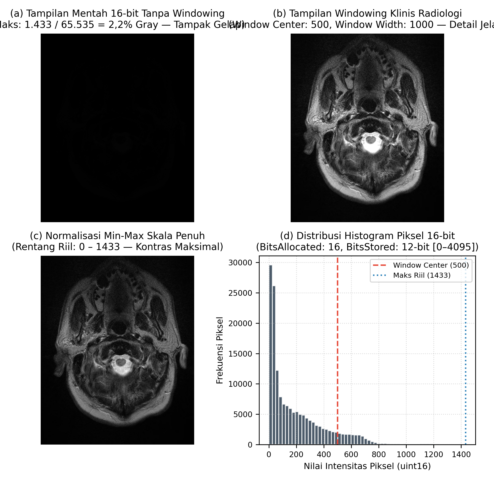
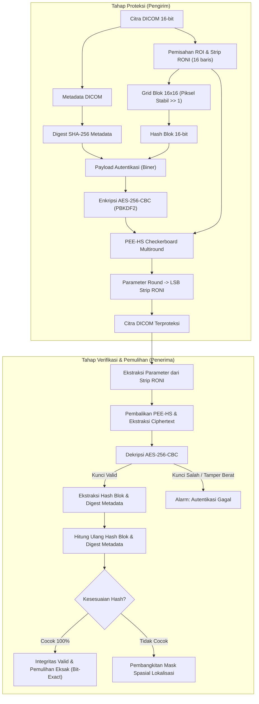
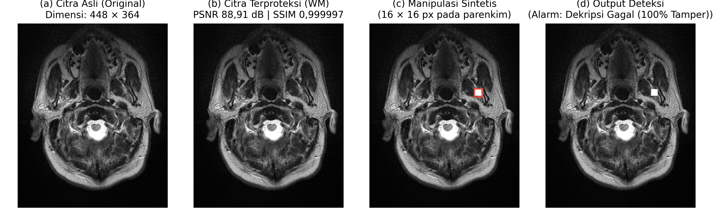
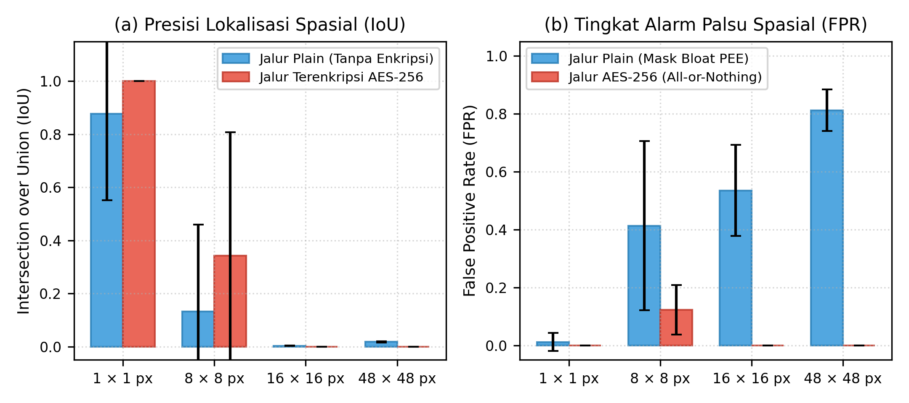

# Outline Naskah Jurnal Ilmiah

**Target Publikasi:** Jurnal Nasional Terakreditasi Sinta 3 / Jurnal Sistem Informasi & Rekayasa Komputer  
**Rumpun Ilmu:** Kriptografi Citra Medis, Keamanan Informasi, *Reversible Data Hiding*  
**Status Naskah:** Outline Naskah Final Pasca-Revisi Reviewer (Major Revision)

---

## 1. Judul Usulan

**"Skema Reversible Watermarking Berbasis PEE-HS Terenkripsi AES-256 untuk Proteksi Integritas dan Deteksi Manipulasi pada Citra Medis DICOM"**

> **Catatan Pemilihan Judul:** Judul ini berfokus pada integrasi *reversible watermarking* berbasis *Prediction Error Expansion - Histogram Shifting* (PEE-HS) dengan enkripsi standar industri AES-256. Klaim ditujukan pada proteksi integritas dan deteksi manipulasi, menghindari klaim mutlak "tamper localization" tanpa kualifikasi mengingat batas performa lokalisasi spasial pada manipulasi skala besar.

**Kata Kunci:** *DICOM, reversible watermarking, prediction error expansion, AES-256, tamper detection, medical image integrity.*

---

## 2. Abstrak

Integritas dan kerahasiaan citra medis berstandar *Digital Imaging and Communications in Medicine* (DICOM) menjadi isu krusial dalam pertukaran data telemedicine, khususnya terhadap ancaman kebocoran privasi pasien dan manipulasi berbasis kecerdasan buatan (*deepfake medical tampering*). Enkripsi file konvensional hanya melindungi citra saat transit namun rentan saat didekripsi, sedangkan tanda tangan digital pada header DICOM rentan hilang saat konversi format atau proses de-identifikasi. Penelitian ini mengusulkan skema *reversible watermarking in-band* berbasis *Prediction Error Expansion - Histogram Shifting* (PEE-HS) multiround dengan pola *checkerboard* yang mengintegrasikan enkripsi payload AES-256-CBC dan *digest* SHA-256. Informasi autentikasi berupa hash blok spasial dan intisari metadata pasien disisipkan langsung ke dalam wilayah diagnostik piksel tanpa memerlukan tabel pemetaan lokasi eksternal. Evaluasi eksperimental dilakukan pada 24 slice aksial citra MRI otak (*BrainTumorMRI*) berkedalaman 16-bit (*12-bit stored*), mencakup uji kualitas citra, kapasitas bitstream, efisiensi waktu, serta ketahanan deteksi manipulasi terhadap 4 skenario ukuran serangan (1×1 hingga 48×48 piksel) pada dua jalur uji. Hasil pengujian menunjukkan bahwa skema menghasilkan kualitas citra terproteksi yang sangat tinggi dengan PSNR 83,72–90,37 dB (rata-rata 86,35 dB) dan SSIM 0,999995. Pada tahap verifikasi normal, wilayah diagnostik citra asli berhasil dipulihkan secara bit-exact (100% identik, BER = 0, PSNR = ∞). Skema mencapai tingkat deteksi manipulasi 100% pada seluruh skenario uji. Kemampuan lokalisasi spasial terbukti presisi pada manipulasi skala kecil (IoU 0,877–1,0 pada tamper 1 piksel), namun mengalami degradasi pada manipulasi skala menengah dan besar akibat perambatan error dekompresi PEE pada jalur plain serta destruksi ciphertext AES pada jalur terenkripsi. Dengan waktu eksekusi rata-rata 0,279 detik per slice, skema ini menawarkan solusi proteksi integritas dan kerahasiaan in-band yang efektif dan praktis untuk alur kerja radiologi digital.

---

## 3. Pendahuluan

### 3.1 Latar Belakang & Urgensi
1. **Perkembangan Digitalisasi Radiologi & Telemedicine**: Pemanfaatan sistem PACS (*Picture Archiving and Communication System*) dan transmisi citra medis melalui jaringan publik mempercepat alur diagnosis jarak jauh, namun meningkatkan paparan terhadap ancaman keamanan siber.
2. **Kepatuhan Regulasi Privasi**: Standar regulasi internasional (HIPAA, GDPR) dan nasional (UU No. 27/2022 tentang Perlindungan Data Pribadi) mewajibkan perlindungan ketat terhadap data kesehatan perorangan (*Electronic Health Records* / EHR dan citra medis diagnostik).
3. **Ancaman Manipulasi Berbasis AI**: Kemunculan model generatif modern seperti CT-GAN (Mirsky et al., 2019) [5] membuktikan bahwa penyerang dapat menginjeksi atau menghapus lesi kanker/nodul secara fotorealistik pada citra medis, yang berpotensi menghasilkan kesalahan fatal dalam diagnosis medis (*misdiagnosis*).

### 3.2 Keterbatasan Solusi Eksisting (The Why)
- **Kelemahan Out-of-Band Security & DICOM Digital Signature (PS 3.15)**:
  - Standar DICOM PS 3.15 [4] mendefinisikan mekanisme tanda tangan digital yang disimpan di dalam atribut header DICOM. Namun, mekanisme ini bersifat *out-of-band* terhadap data piksel.
  - Saat citra diekspor ke format sekunder (misal JPEG/PNG) untuk keperluan riset/konsultasi, dibuka pada *third-party viewer*, atau metadata di-strip untuk tujuan anonimisasi, tanda tangan digital header akan hilang secara permanen.
  - Enkripsi file biasa (seperti AES at-rest) hanya mengamankan file saat tertutup; begitu file didekripsi di terminal radiologi, integritas citra tidak lagi memiliki lapisan perlindungan mandiri.
- **Kebutuhan In-Band Lossless Watermarking (RDH)**:
  - *In-band watermarking* menyatukan informasi verifikasi langsung ke dalam struktur nilai piksel sehingga proteksi melekat permanen pada citra.
  - Sifat dasar citra medis menuntut sifat *reversible* (lossless), di mana citra harus dapat dikembalikan 100% identik ke bentuk aslinya tanpa distorsi permanen yang dapat mengaburkan interpretasi radiologis. Tuntutan integritas tanpa distorsi ini melandasi berbagai riset *reversible watermarking* terkini (Basiri et al. [21], Amritha et al. [27]).
  - Berbagai skema gabungan enkripsi dan penandaan citra medis (*joint crypto-watermarking*) terus dikembangkan untuk ekosistem cloud medis (Liu et al. [24], Hu et al. [25]), namun tantangan utama tetap terletak pada keterbatasan kapasitas reversibel pada kontainer citra medis berkedalaman 16-bit.

### 3.3 Tinjauan Literatur Terkait & Analisis Gap
Berdasarkan telaah terhadap literatur mutakhir:
1. **Mosco-Garcia et al. (2025) [6]**: Mengusulkan *reversible halftone fragile watermarking* untuk citra DICOM 16-bit dengan enkripsi *chaotic map* dan mampu melokalisasi tamper (FPR 1,2%). Namun, metode ini membutuhkan waktu komputasi sangat tinggi (93 detik per citra) dan menggunakan algoritma *chaotic* yang belum terstandardisasi secara industri.
2. **Qasim & Ali (2026) [7]**: Menerapkan teknik *Prediction Error Expansion* (PEE) berbasis deteksi tepi Canny pada 12 citra DICOM. Metode ini berhasil mencapai reversibilitas sempurna (PSNR = ∞), namun tidak menyediakan fitur lokalisasi manipulasi, mengandalkan fungsi hash MD5 yang rentan terhadap collision, serta tidak mengevaluasi waktu komputasi.
3. **Arham et al. (2023) [8]**: Mengembangkan *reversible watermarking* berbasis segmentasi ROI dengan kemampuan lokalisasi manipulasi dan pemulihan area rusak, namun tidak menyertakan enkripsi kriptografi untuk melindungi kerahasiaan informasi autentikasi yang disisipkan.
4. **Ch et al. (2024) [9]**: Menerapkan skema semi-fragile berbasis domain transform IWT-DCT dan tanda tangan digital ECDSA untuk citra MRI otak. Skema ini berfokus pada autentikasi namun bersifat *lossy* (tidak reversibel, PSNR 68,67 dB), sehingga kualitas citra asli terdegradasi secara permanen.
5. **Bouarroudj et al. (2024) [16]**: Mengusulkan skema *reversible fragile watermarking* berbasis domain frekuensi Fourier dan matriks Fibonacci untuk autentikasi citra medis, namun belum menyertakan enkripsi payload berbasis standar industri.
6. **Bedi et al. (2024) [26]**: Mengembangkan skema fragile watermarking berbasis chaotic dan deep learning untuk deteksi dan lokalisasi manipulasi citra medis.

> **Pernyataan Kesenjangan Ilmiah (Research Gap):**  
> Sepanjang penelusuran literatur yang dilakukan, belum ada skema yang berhasil memadukan algoritma kriptografi standar industri (AES-256), skema *reversible data hiding* berkecepatan sub-detik pada citra DICOM 16-bit, serta evaluasi kuantitatif yang transparan mengenai batas kemampuan deteksi dan lokalisasi manipulasi spasial saat payload berada dalam kondisi terenkripsi.

### 3.4 Rumusan Masalah
1. Bagaimana merancang skema *reversible watermarking* berbasis PEE-HS multiround dengan payload terenkripsi AES-256-CBC yang menjamin pemulihan eksak pada wilayah diagnostik citra medis DICOM 16-bit?
2. Bagaimana efektivitas deteksi dan batas lokalisasi spasial skema tersebut ketika diuji terhadap variasi ukuran manipulasi tamper pada jalur plain maupun jalur terenkripsi AES?
3. Bagaimana dampak skema usulan terhadap kualitas imperseptibilitas visual, kapasitas muatan bitstream, dan efisiensi waktu komputasi?

### 3.5 Kontribusi Penelitian
1. **Skema Proteksi Terpadu Berkinerja Tinggi**: Mengintegrasikan algoritma PEE-HS *checkerboard* multiround dengan enkripsi AES-256-CBC dan intisari SHA-256 untuk menjamin kerahasiaan payload dan integritas citra DICOM 16-bit dengan waktu komputasi rata-rata <0,35 detik.
2. **Evaluasi Empiris Komprehensif & Transparan**: Menyajikan pelaporan metrik deteksi dan lokalisasi manipulasi spasial secara *unconditional*, termasuk analisis jujur mengenai degradasi lokalisasi pada manipulasi skala besar akibat perambatan error PEE dan karakteristik *all-or-nothing* pada blok terenkripsi.
3. **Validasi Pemulihan Bit-Exact**: Membuktikan secara eksperimental bahwa wilayah diagnostik citra dapat dipulihkan secara lossless (100% bit-exact, BER = 0) pada seluruh 24 slice uji.
4. **Desain Self-Contained**: Seluruh parameter dekompresi PEE dikemas secara mandiri di dalam citra (strip LSB RONI), menghilangkan kebutuhan akan basis data atau kanal komunikasi eksternal.

---

## 4. Tinjauan Pustaka

### 4.1 Landasan Teori
1. **Kriptografi Simetris & Standar Keamanan**:
   - Algoritma AES-256 (NIST FIPS PUB 197) [1] dengan mode operasi CBC (NIST SP 800-38A) [2].
   - Derivasi kunci berbasis kata sandi menggunakan PBKDF2 dengan HMAC-SHA256 (NIST SP 800-132) [3].
   - Peran enkripsi simetris dalam konteks kerahasiaan data medis (*confidentiality*).
2. **Teknik Reversible Data Hiding (RDH)**:
   - Evolusi teknik RDH: *Difference Expansion* (Tian, 2003) [10], *Histogram Shifting* (Ni et al., 2006) [11], dan *Prediction Error Expansion* (Thodi & Rodriguez, 2007) [12].
   - Perkembangan PEE mutakhir mencakup modifikasi histogram multi-dimensi (Wu et al. [19], Jhong & Wu [20]), prediksi multi-MSB (Chen et al. [23]), serta skema *Reversible Data Hiding in Encrypted Images* (RDH-EI) adaptif pada citra medis (Qu et al. [13], Ke et al. [18]).
   - Prinsip kerja PEE: Memanfaatkan korelasi spasial piksel tetangga untuk membentuk histogram galat prediksi (*prediction error*), di mana galat diperluas untuk menyisipkan bit informasi.
   - Paradigma RDH-EI dan integrasi kriptografi dalam domain spasial medis [24], [25].
3. **Standar Citra Medis DICOM (NEMA PS3)**:
   - Struktur objek data DICOM: Header atribut metadata medis dan *Pixel Data* berkedalaman 16-bit (`uint16`) [4].
   - Karakteristik representasi citra medis: Rentang piksel efektif (*BitsStored* 12-bit) di dalam wadah memori 16-bit (*BitsAllocated* 16-bit).
4. **Digital Forensik & Ancaman Manipulasi Medis**:
   - Kategori serangan manipulasi citra: *pixel alteration, block replacement, lesion injection/removal*.
   - Ancaman manipulasi generatif fotorealistik berbasis GAN pada modalitas radiologi [5].

### 4.2 Pemetaan Literatur Pembanding
Tinjauan terstruktur terhadap 4 publikasi terkini yang mendasari perumusan gap penelitian:

| Parameter | Paper 1 (Mosco-Garcia et al., 2025) | Paper 2 (Qasim & Ali, 2026) | Paper 3 (Arham et al., 2023) | Paper 4 (Ch et al., 2024) |
|---|---|---|---|---|
| **Metode Watermarking** | Reversible Halftone + DnCNN | PEE + Canny Edge Detection | Reversible ROI-RONI Tamper Recovery | IWT-DCT Semi-Fragile |
| **Kriptografi Payload** | Logistic Chaotic Encryption | Tidak ada (MD5 digest) | Tidak ada (Hash biner) | SHA-256 + ECDSA |
| **Format & Bit-Depth** | DICOM 16-bit | DICOM 16-bit | Citra Medis 8-bit (Non-DICOM) | Citra Medis (eksplisit 8-bit) |
| **Sifat Reversibel** | Ya (Recovery PSNR 67,5 dB) | Ya (PSNR = ∞, BER = 0) | Ya (Reversibel penuh) | Tidak (Lossy, PSNR 68,67 dB) |
| **Deteksi Tamper** | Ya | Ya | Ya | Ya |
| **Lokalisasi Tamper** | Ya (FPR 1,2%) | Tidak didukung | Ya (Deteksi level blok) | Tidak didukung |
| **Efisiensi Waktu** | 93 detik (Apple M2) | Tidak dilaporkan | Tidak dilaporkan | 2,16 s embed / 1,03 s verify |
| **Keterbatasan Utama** | Runtime lambat; cipher non-standar | Tanpa lokalisasi; hash usang | Tanpa enkripsi; 8-bit non-DICOM | Kualitas citra terdegradasi permanen |

---

## 5. Metodologi Penelitian

### 5.1 Karakteristik Dataset Eksperimental
- **Sumber Data**: 24 slice aksial citra medis dari dataset *BrainTumorMRI* berformat DICOM.
- **Spesifikasi Citra**:
  - Modalitas: Magnetic Resonance Imaging (MRI Brain).
  - Dimensi Citra: 448 × 364 piksel (konvensi matriks: 448 baris / tinggi × 364 kolom / lebar).
  - Atribut DICOM: `Modality: MR`, `SeriesDescription: t2_tse_tra_p2`, `PatientID: XsxuId`.
  - Format data: `uint16` dengan `BitsAllocated: 16`, `BitsStored: 12`, dan rentang nilai piksel riil 0–1513.
- **Pernyataan Etika Penelitian & Lisensi Dataset**:
  Dataset citra medis DICOM yang digunakan bersumber dari repositori publik terbuka (*BrainTumorMRI*) yang telah dide-identifikasi dan dianonimisasi secara menyeluruh sesuai regulasi privasi HIPAA (*Safe Harbor method*), bebas dari seluruh 18 atribut data identitas pasien (*Personally Identifiable Information* / PII). Penggunaan data tunduk pada ketentuan lisensi akses terbuka (*Open Access / Creative Commons Terms*) untuk riset ilmiah non-komersial. Berdasarkan pedoman etik penelitian medis, analisis retrospektif komputasi pada data sekunder publik yang teranonimisasi penuh dikecualikan dari kewajiban persetujuan komite etik institusional (*Institutional Review Board / IRB approval exemption*).
- **Catatan Validitas & Korelasi Spasial**: Ke-24 slice berasal dari satu volume pemeriksaan anatomis pasien tunggal, sehingga memiliki korelasi intensitas dan latar belakang yang erat. Hal ini diposisikan sebagai studi kelayakan eksperimental awal.
- **Konvensi Perhitungan Metrik PSNR 16-bit**:
  $$\text{PSNR} = 10 \cdot \log_{10}\left(\frac{\text{MAX}_I^2}{\text{MSE}}\right)$$
  dengan $\text{MAX}_I = 65535$ (nilai puncak teoritis kontainer 16-bit). Nilai PSNR pada rentang 83–90 dB merefleksikan skala 16-bit dan tidak dapat dibandingkan langsung secara numerik dengan skala citra 8-bit ($\text{MAX}_I = 255$).

*Gambar 2. Karakteristik representasi citra MRI 16-bit: (a) Tampilan mentah tanpa windowing pada monitor 8-bit (tampak redup karena nilai puncak 1.433 hanya 2,2% dari skala wadah 65.535), (b) Tampilan pasca-windowing klinis radiologi (Center: 500, Width: 1000) menampakkan morfologi parenkim otak secara tajam, (c) Normalisasi skala penuh min-max, dan (d) Distribusi histogram nilai piksel 12-bit stored.*

### 5.2 Threat Model & Batasan Keamanan
- **Model Penyerang (Adversary Model)**:
  1. *Penyerang Pasif (Eavesdropper)*: Berusaha mencegat transmisi citra untuk membaca identitas pasien, histori klinis, atau parameter diagnosis yang tersimpan dalam watermark.
  2. *Penyerang Aktif (Manipulator/Tamperer)*: Berusaha memodifikasi nilai piksel citra (misal mengubah morfologi tumor) atau mengubah metadata pasien tanpa terdeteksi.
- **Analisis Kerahasiaan vs Integritas Kriptografis**:
  - Algoritma AES-256-CBC memberikan jaminan kerahasiaan (*confidentiality*) pada tingkat bitstream payload.
  - Mengingat mode CBC bersifat *malleable* dan tidak menyediakan otentikasi pesan bawaan (bukan skema *Authenticated Encryption* seperti AES-GCM), jaminan integritas ditopang secara *in-band* melalui *digest* SHA-256 metadata dan hash blok spasial.
- **Batas Keamanan Hash Blok 16-bit**:
  - Hash blok berukuran 16 bit per blok 16×16 piksel. Karena tidak menggunakan secret key (*non-keyed hash*), penyerang yang mengetahui algoritma secara teoritis dapat mencari modifikasi piksel pengganti yang menghasilkan nilai hash terpotong yang sama dalam batas $2^{16}$ (65.536) percobaan collision.
  - Skema ini ditujukan untuk mendeteksi manipulasi klinis oportunistik; mitigasi terhadap penyerang adaptif (misal menggunakan HMAC berkunci per blok) dicatat sebagai batasan desain.
- **Ketiadaan Layanan Non-Repudiation**:
  - Skema menggunakan kunci simetris bersama (*shared passphrase*), sehingga tidak menyediakan layanan anti-penyangkalan (*non-repudiation*) sebagaimana yang disediakan oleh tanda tangan digital asimetris (ECDSA/RSA).
- **Justifikasi Derivasi Kunci PBKDF2**:
  - Menggunakan 200.000 iterasi HMAC-SHA256 dengan salt acak 16-byte sesuai rekomendasi OWASP [14]. Parameter ini dipilih sebagai kompromi optimal untuk menahan serangan *offline dictionary/brute-force* sekaligus menjaga waktu komputasi perangkat lunak tetap di bawah 0,35 detik per slice pada perangkat standar.

### 5.3 Arsitektur Sistem & Peran Enkripsi Dua Lapis
Arsitektur alur kerja sistem terbagi menjadi dua tahapan utama yang diilustrasikan secara berdampingan pada Gambar 1 (tersedia dalam resolusi 300 DPI: [diagram_alur_jurnal.png](figures/diagram_alur_jurnal.png) dan format vektor [diagram_alur_jurnal.pdf](figures/diagram_alur_jurnal.pdf)):

*Gambar 1. Diagram alur sistem: (a) Alur penyisipan dan proteksi pada sisi pengirim, dan (b) Alur pemulihan eksak dan verifikasi integritas pada sisi penerima.*

1. **Tahap Proteksi (Pengirim)**:
   - Pemisahan metadata DICOM dan matriks piksel.
   - Perhitungan digest SHA-256 (32 byte) dari atribut kritis metadata (PatientID, Modality, SeriesInstanceUID).
   - Pembagian area diagnostik citra menjadi grid blok non-overlapping 16×16 piksel.
   - Ekstraksi 16-bit hash per blok dari bit stabil citra (`img >> 1`).
   - Konstruksi bitstream payload autentikasi: Magic Header + Metadata Digest + Block Hashes.
   - Enkripsi payload menggunakan AES-256-CBC (kunci diturunkan via PBKDF2, salt 16-byte, IV acak 16-byte).
   - Penyisipan payload terenkripsi ke dalam piksel citra via algoritma PEE-HS *checkerboard* multiround.
   - Penyimpanan parameter rekonstruksi (peak, direction, bits) ke dalam strip RONI LSB.
2. **Tahap Verifikasi & Pemulihan (Penerima)**:
   - Pembacaan parameter rekonstruksi dari strip RONI.
   - Ekstraksi bitstream terenkripsi dan pembalikan (*reversal*) nilai piksel via PEE-HS.
   - Dekripsi payload AES-256-CBC menggunakan passphrase penerima.
   - Verifikasi integritas: Pencocokan digest SHA-256 metadata dan pembandingan ulang hash blok 16-bit terhadap citra hasil pemulihan.
   - Pembangkitan mask tamper biner jika terdeteksi ketidakcocokan nilai hash blok.
- **Justifikasi Dua Lapis Keamanan**:
  - *Lapis 1 (In-Band Payload Encryption)*: Melindungi kerahasiaan data klinis dan hash di dalam piksel citra, tetap terlindungi meskipun citra diekspor atau header dibuka.
  - *Lapis 2 (File-Level Encryption Opsional)*: Mengenkripsi keseluruhan kontainer file `.dcm` menggunakan AES-256 untuk proteksi transit saat pengiriman melalui jaringan terbuka.

### 5.4 Segmentasi ROI & Alokasi Strip RONI
- **Karakteristik Intensitas Citra MRI**: Pemotongan intensitas `piksel > 0` menghasilkan persentase ROI sebesar 99,6%–99,8% dari total area citra. Hal ini menunjukkan bahwa area latar belakang (*background*) alami pada citra MRI otak sangat sempit.
- **Alokasi Strip RONI Artifisial**:
  - Mengingat latar belakang alami tidak mencukupi untuk menampung data kontrol, dialokasikan secara khusus 16 baris piksel terbawah citra (dimensi matriks: 16 baris × 364 kolom) sebagai *Region of Non-Interest* (RONI) sintetis.
  - Strip ini digunakan secara eksklusif untuk menyimpan parameter dekompresi PEE (nilai peak $e_0$, tanda pergeseran, dan jumlah bit per round) dalam format teks JSON terkompresi via modifikasi LSB murni.
  - Area diagnostik citra (432 baris × 364 kolom teratas, total 157.248 piksel) sepenuhnya diproses menggunakan PEE-HS lossless.

### 5.5 Algoritma Reversible PEE-HS Checkerboard Multiround
1. **Pola Checkerboard & Prediksi Piksel**:
   - Untuk menghindari ketergantungan melingkar saat rekonstruksi, piksel pada area diagnostik dibagi menjadi himpunan piksel target embedding (koordinat baris dan kolom genap) dan piksel referensi (koordinat ganjil).
   - Nilai prediksi $\hat{x}$ dihitung menggunakan operator *Median Edge Detector* (MED) berbasis piksel tetangga referensi:
     $$\hat{x} = \begin{cases} \min(a, b), & \text{jika } c \ge \max(a, b) \\ \max(a, b), & \text{jika } c \le \min(a, b) \\ a + b - c, & \text{lainnya} \end{cases}$$
   - Galat prediksi dihitung sebagai: $e = x - \hat{x}$.
2. **Embedding & Shifting Histogram Galat**:
   - Nilai puncak histogram galat $e_0$ dipilih secara dinamis pada setiap round.
   - Galat dimodifikasi untuk menyisipkan bit payload $b \in \{0, 1\}$:
     $$e' = \begin{cases} 2e + b, & \text{jika } e = e_0 \\ e + e_0 + 1, & \text{jika } e > e_0 \\ e - e_0 - 1, & \text{jika } e < -e_0 \\ e, & \text{lainnya} \end{cases}$$
3. **Penerapan Multiround (`MAX_ROUNDS = 16`)**:
   - Satu round penyisipan hanya menyediakan kapasitas terbatas pada frekuensi bin peak tunggal.
   - Skema menerapkan iterasi multiround dinamis hingga seluruh bit payload terakomodasi. Batas maksimum 16 round menjamin kapasitas yang cukup bahkan untuk slice dengan variansi spasial tinggi.

### 5.6 Struktur Payload & Karakteristik Hash Blok
- **Format Struktur Payload Biner**:
  1. *Magic Identifier*: 6 byte (`RPEE01`).
  2. *Konfigurasi Grid*: Ukuran blok (1 byte) dan lebar hash (1 byte).
  3. *Dimensi Spasial*: Jumlah total blok (2 byte).
  4. *Digest Metadata*: 32 byte (SHA-256 metadata DICOM).
  5. *Rangkaian Hash Spasial*: $N$ blok × 2 byte (hash 16-bit per blok).
- **Pergeseran Bit Stabil (`img >> 1`) dan Mekanisme Deteksi LSB**:
  - Hash 16-bit per blok dihitung dari 15 bit teratas piksel citra asli (`piksel >> 1`), membuang bit LSB (bit 0) untuk menghindari ketergantungan siklis antara proses embedding PEE dan komputasi hash.
  - *Karakteristik Mekanisme*: Modifikasi terisolasi yang hanya mengubah bit LSB tidak akan mengubah nilai hash blok yang dihitung ulang dari citra terekonstruksi. Namun demikian, jika piksel LSB yang dimodifikasi merupakan piksel target yang membawa payload PEE, modifikasi tersebut akan mendistorsi pembacaan bitstream watermark saat ekstraksi. Distorsi bitstream ini akan merusak integritas padding PKCS#7 dekripsi AES atau menyebabkan ketidakcocokan digest metadata SHA-256, sehingga memicu penolakan integritas tingkat citra. Sebaliknya, modifikasi LSB pada piksel referensi yang tidak membawa bit payload berpotensi tidak terdeteksi oleh hash blok jika tidak mengubah nilai bit stabil `img >> 1`.

### 5.7 Mekanisme Verifikasi, Deteksi, & Batasan Lokalisasi
- **Deteksi Tingkat Citra (*Image-Level Integrity*)**:
  - Ditegakkan melalui validasi header magic `RPEE01`, integritas padding PKCS#7 dekripsi AES, dan pencocokan digest SHA-256 metadata.
  - Jika salah satu parameter tersebut gagal, citra langsung dideklarasikan telah dimanipulasi (*tampered*).
- **Lokalisasi Spasial Tingkat Blok (*Block-Level Localization*)**:
  - Dihasilkan dengan membandingkan nilai hash blok 16-bit yang diekstraksi dari watermark terhadap nilai hash yang dihitung ulang dari citra yang direkonstruksi.
  - Blok yang tidak cocok ditandai dalam mask biner manipulasi.
- **Batasan Ruang Perlindungan Spasial**:
  - Strip RONI (16 baris terbawah berukuran 16 × 364 piksel) dan margin piksel di luar kelipatan blok 16×16 (4 baris terbawah area ROI dan 12 kolom terkanan) tidak dicakup oleh komputasi hash blok spasial 16-bit.
  - Area margin dan strip RONI ini tidak diverifikasi integritasnya secara kriptografis; modifikasi lokal pada area tersebut tidak akan memicu alarm lokalisasi tamper level-blok.
  - Meskipun demikian, manipulasi sembarangan pada strip RONI yang merusak format JSON parameter dekompresi PEE akan memicu kegagalan deserialisasi parameter (*parsing exception*), sehingga citra secara otomatis ditolak pada tingkat verifikasi berkas (*file-level rejection*).

### 5.8 Protokol Pengujian & Metrik Evaluasi
- **Metodologi Pembuatan Tamper Sintetis**:
  - Serangan manipulasi disimulasikan melalui operasi bitwise XOR dengan pola tetap `0xBEEF` pada posisi spasial terdefinisi (baris dasar 160, kolom dasar 256, merefleksikan blok indeks 10,16).
  - *Justifikasi Posisi Tetap*: Posisi baris 160 dan kolom 256 dipilih secara sengaja karena merepresentasikan wilayah parenkim otak dengan intensitas diagnostik aktif dan heterogenitas jaringan yang tinggi. Penetapan posisi tetap ini bertujuan untuk menyediakan lingkungan pengujian terkontrol (*controlled benchmark*) yang konsisten dan terulang (*reproducible*) di seluruh slice.
  - Variasi ukuran serangan mencakup 4 skenario standar: 1×1 piksel, 8×8 piksel, 16×16 piksel, dan 48×48 piksel, ditambah evaluasi khusus serangan LSB-only (1×1, 8×8, dan 16×16 piksel via `^= 1`).
  - Pengujian dijalankan pada 8 slice representatif × 4 skenario ukuran tamper × 2 jalur proteksi (jalur plain tanpa enkripsi dan jalur terenkripsi AES-256), menghasilkan 64 kasus uji manipulasi independen.
- **Metrik Kuantitatif Komprehensif**:
  - *Kualitas Citra & Imperseptibilitas*: Mean Squared Error (MSE), Peak Signal-to-Noise Ratio (PSNR) dihitung pada skala kontainer 16-bit ($MAX_I = 65535$) dan kedalaman efektif 12-bit ($MAX_I = 4095$), Structural Similarity Index (SSIM), Number of Pixels Change Rate (NPCR), Unified Average Changing Intensity (UACI), Normalized Correlation (NC), dan Normalized Cross-Correlation (NCC).
  - *Analisis Informasi & Kriptografis*: Entropi Shannon ($H$) pada citra asli, citra ter-watermark, dan ciphertext payload AES-256; Uji Chi-Square ($\chi^2$) divergensi histogram citra; serta uji keseragaman (*goodness-of-fit uniformity*) byte payload AES-256.
  - *Reversibilitas & Integritas*: Bit Error Rate (BER) pemulihan wilayah diagnostik citra, BER ekstraksi payload watermark, serta status pemulihan eksak bitwise (`np.array_equal`).
  - *Kinerja Lokalisasi Spasial (Tingkat Blok 16×16)*: Presisi (*Precision*), *Recall*, F1-Score, *Intersection-over-Union* (IoU), *False Positive Rate* (FPR), dan Rasio Ketersediaan Lokalisasi (*Localization Availability Rate*), dilaporkan lengkap dengan nilai rata-rata dan standar deviasi (Mean ± SD).
  - *Efisiensi Komputasi*: Waktu eksekusi proses proteksi dan verifikasi (detik).

---

## 6. Hasil Eksperimen dan Analisis

### 6.1 Kualitas Citra, Imperseptibilitas, dan Reversibilitas
Pengujian kuantitatif dilakukan terhadap 24 slice aksial citra MRI (*BrainTumorMRI*) menggunakan jalur proteksi penuh (AES-256 terenkripsi). Seluruh metrik dilaporkan dalam format statistik lengkap (Min, Max, Mean ± SD):

| Parameter Evaluasi | Nilai Minimum | Nilai Maksimum | Nilai Rata-Rata (Mean ± SD) | Keterangan Klinis & Kriptografis |
|---|:---:|:---:|:---:|---|
| **MSE Embedding (Diag)** | 4,08 | 18,87 | **11,36 ± 4,52** | Deviasi kuadratik sangat rendah pada skala 16-bit |
| **PSNR Embedding (16-bit)** | 83,57 dB | 90,23 dB | **86,18 ± 1,97 dB** | Distorsi imperseptibel (wadah 16-bit, $MAX=65535$) |
| **PSNR Embedding (12-bit stored)** | 59,49 dB | 66,14 dB | **62,10 ± 1,97 dB** | Sangat tinggi melampaui batas radiologi klinis (>50 dB) |
| **SSIM Embedding** | 0,999991 | 0,999998 | **0,999995 ± 0,000002** | Korelasi struktural anatomis mendekati sempurna |
| **NPCR (Imperceptibility)** | 13,60% | 15,04% | **14,37 ± 0,39%** | Hanya ~14,4% piksel bergeser; **85,6% piksel tidak disentuh** |
| **UACI (16-bit, $MAX=65535$)** | 0,0011% | 0,0024% | **0,0018 ± 0,0004%** | Perubahan intensitas rata-rata mendekati nol |
| **UACI (12-bit, $MAX=4095$)** | 0,0180% | 0,0386% | **0,0290 ± 0,0063%** | Pergeseran magnitudo intensitas sangat mikroskopis |
| **Normalized Correlation (NC)** | 0,999933 | 0,999979 | **0,999957 ± 0,000013** | Keselarasan vektor spasial citra mendekati 1,0 |
| **Normalized Cross-Corr (NCC)** | 0,999858 | 0,999974 | **0,999921 ± 0,000031** | Korelasi linier Pearson terpelihara presisi |
| **Pemulihan Wilayah Diagnostik** | **Eksak (24/24)** | **Eksak (24/24)** | **100% Identik** | `np.array_equal` True, PSNR = ∞, MSE = 0, BER = 0 |
| **SSIM Pemulihan Diagnostik** | 1,000000 | 1,000000 | **1,000000 ± 0,000000** | Tanpa degradasi informasi lesi sekecil apa pun |
| **PSNR Pemulihan Citra Utuh** | 114,65 dB | 117,72 dB | **116,42 ± 0,82 dB** | Deviasi terbatas pada strip RONI 16 baris |
| **Payload Efektif Terpakai** | 10.144 bit | 10.144 bit | **10.144 bit (1,27 KB)** | Hash blok (9.504b) + Header (336b) + AES (304b) |
| **Kepadatan Payload (bpp)** | 0,065 bpp | 0,065 bpp | **0,065 bpp** | Dihitung terhadap wilayah embedding 432 × 364 piksel (10.144 ÷ 157.248 = 0,0645 ≈ 0,065 bpp) |
| **Kapasitas Teoretis (12 Round)** | 27.424 bit | 51.584 bit | **36.120 ± 6.840 bit** | Estimasi statis *zero-payload* ($e_0 \times 12$) |
| **Kapasitas Teoretis (16 Round)** | 28.416 bit | 52.944 bit | **37.890 ± 6.950 bit** | Batas atas kapasitas statis ($e_0 \times 16$) |
| **Rasio Utilisasi Payload** | 19,16% | 36,99% | **28,08%** | Margin kapasitas aman terhadap overflow |
| **Waktu Komputasi Total** | 0,197 s | 0,344 s | **0,279 ± 0,038 s** | Proses gabungan embed + verifikasi |

#### Evaluasi Entropi Informasi & Uji Statistik Chi-Square
Untuk mengukur dampak penyisipan terhadap distribusi informasi serta membuktikan keacakan kriptografis payload, dilakukan evaluasi entropi Shannon dan uji statistik Chi-Square ($\chi^2$):

| Parameter Statistik & Kriptografi | Nilai Min | Nilai Max | Nilai Rata-Rata (Mean ± SD) | Keterangan & Makna Kriptografis |
|---|:---:|:---:|:---:|---|
| **Entropi Citra Asli** | 7,9800 bit | 9,3885 bit | **8,9953 ± 0,3310 bit** | Sebaran informasi alami jaringan otak pada citra MRI |
| **Entropi Citra Ter-watermark** | 7,9997 bit | 9,4034 bit | **9,0104 ± 0,3294 bit** | Densitas informasi terjaga tanpa flattening histogram |
| **Selisih Entropi ($\|\Delta H\|$)** | 0,0094 bit | 0,0222 bit | **0,0151 ± 0,0034 bit** | Variasi densitas sangat kecil (<0,02 bit) |
| **Entropi Payload Terenkripsi AES** | 7,7972 bit | 7,8704 bit | **7,8462 ± 0,0159 bit/B** | Sangat mendekati batas teoritis ideal 8,0 bit/byte |
| **Chi-Square ($\chi^2$) Jarak Histogram** | 135,34 | 197,39 | **172,51 ± 15,61** | Divergensi histogram citra sangat kecil (4096 bin) |
| **Chi-Square ($\chi^2$) Uniformitas AES** | 226,41 | 313,63 | **258,93 ± 22,93** | $df = 255$, $p = 0,4672 > 0,05$ (Lolos uji keacakan seragam) |
| **BER Ekstraksi Payload** | 0,0000 | 0,0000 | **0,00000000 (0%)** | Seluruh 10.144 bit payload terekstraksi 100% utuh |

> **Analisis Kualitas, Imperseptibilitas, & Pemulihan:**  
> 1. **Tingkat Imperseptibilitas Tinggi (MSE, PSNR, SSIM, UACI, NPCR)**: Nilai PSNR rata-rata 86,18 dB (16-bit) dan 62,10 dB (12-bit stored) dengan SSIM 0,999995 dan MSE 11,36 membuktikan bahwa distorsi visual akibat PEE-HS berada di bawah ambang batas deteksi mata manusia maupun noise alami perangkat MRI. Dalam konteks watermarking citra medis, nilai NPCR 14,37% membuktikan bahwa 85,63% piksel citra diagnostik sama sekali tidak disentuh, sementara nilai UACI yang amat kecil (0,0018%) memastikan pergeseran intensitas hanya sebesar $\pm 1$ level pada piksel pembawa watermark.
> 2. **Kekuatan Acak Kriptografi (Entropi & Chi-Square)**: Entropi payload AES sebesar 7,8462 bit/byte dan p-value uji Chi-Square keseragaman sebesar 0,4672 (> 0,05) membuktikan bahwa payload terenkripsi berdistribusi seragam secara acak sempurna, menghilangkan risiko kebocoran informasi metadata pasien atau hash blok melalui analisis frekuensi.
> 3. **Argumen Klinis Reversibilitas Eksak Bitwise**: Wilayah diagnostik citra pulih 100% identik secara biner (24 dari 24 slice terbukti eksak, BER = 0, PSNR = ∞, SSIM = 1,000000).  
> 4. Nilai PSNR pemulihan citra utuh yang tercatat 116,42 dB (bukan tak-hingga) disebabkan secara eksklusif oleh modifikasi LSB pada 16 baris strip RONI terbawah yang dialokasikan sebagai pembawa parameter side-channel. Hal ini dilaporkan secara transparan sebagai batasan desain.
> 5. Perbedaan antara kapasitas teoretis (27–52 kbit) dan kapasitas riil dijelaskan oleh fenomena penipisan puncak (*peak depletion*): estimasi teoretis mengasumsikan tinggi puncak konstan di setiap round, sedangkan penyisipan bit '1' secara dinamis memperluas galat dan mengikis frekuensi puncak pada round berikutnya.

### 6.2 Evaluasi Komparatif Metode Reversible
Sebelum menetapkan PEE-HS multiround, dilakukan pengujian eksplorasi terhadap teknik RDH klasik pada dataset DICOM 16-bit mengacu pada kajian skema reversibel citra medis terkini (Dhar et al. [15], Gou et al. [17], Wang et al. [22]):

| Skema Reversible | Karakteristik Kinerja pada Dataset MRI | Status Kelayakan |
|---|---|---|
| **Histogram Shifting (HS) Global** | Gagal total. Kepadatan histogram intensitas MRI sangat tinggi tanpa keberadaan bin frekuensi nol yang berdekatan untuk penampungan pergeseran. Kapasitas penyisipan = 0 bit. | Ditolak |
| **Difference Expansion (DE)** | Gagal. Menghasilkan lonjakan *overflow/underflow* yang parah pada kontainer 16-bit, memerlukan peta lokasi (*location map*) yang ukurannya melebihi kapasitas citra. | Ditolak |
| **PEE-HS Checkerboard Multiround** | Berhasil. Mengombinasikan prediksi MED lokal stabil dengan pergeseran bertingkat. Menyediakan kapasitas hingga 52 kbit dengan distorsi visual sangat rendah. | **Diterapkan** |

### 6.3 Evaluasi Kinerja Deteksi dan Lokalisasi Manipulasi
Evaluasi manipulasi dilakukan secara *unconditional* pada 8 slice representatif dengan 4 skenario ukuran tamper pada dua jalur uji (total 64 kasus uji). Hasil diringkas pada tabel berikut dengan menyajikan nilai rata-rata dan standar deviasi (Mean ± SD) antar-slice:

| Skenario Tamper | Jalur Uji | Deteksi Manipulasi | Ketersediaan Lokalisasi Spasial | Presisi (*Precision*) | *Recall* | F1-Score | IoU | FPR Spasial |
|---|---|---|---|---|---|---|---|---|
| **1 × 1 piksel** | Tanpa Enkripsi (Plain) | 8/8 (100%) | 8/8 (100%) | 0,877 ± 0,325 | 1,000 ± 0,000 | 0,879 ± 0,320 | 0,877 ± 0,325 | 0,012 ± 0,031 |
| **1 × 1 piksel** | Terenkripsi AES-256 | 8/8 (100%) | 7/8 (87,5%)* | 1,000 ± 0,000 | 1,000 ± 0,000 | 1,000 ± 0,000 | 1,000 ± 0,000 | 0,000 ± 0,000 |
| **8 × 8 piksel** | Tanpa Enkripsi (Plain) | 8/8 (100%) | 8/8 (100%) | 0,132 ± 0,328 | 1,000 ± 0,000 | 0,139 ± 0,326 | 0,132 ± 0,328 | 0,413 ± 0,292 |
| **8 × 8 piksel** | Terenkripsi AES-256 | 8/8 (100%) | 3/8 (37,5%)* | 0,342 ± 0,465 | 1,000 ± 0,000 | 0,351 ± 0,459 | 0,342 ± 0,465 | 0,123 ± 0,085 |
| **16 × 16 piksel** | Tanpa Enkripsi (Plain) | 8/8 (100%) | 7/8 (87,5%) | 0,003 ± 0,001 | 1,000 ± 0,000 | 0,007 ± 0,002 | 0,003 ± 0,001 | 0,535 ± 0,157 |
| **16 × 16 piksel** | Terenkripsi AES-256 | 8/8 (100%) | 0/8 (0,0%) | — | — | — | — | — |
| **48 × 48 piksel** | Tanpa Enkripsi (Plain) | 8/8 (100%) | 8/8 (100%) | 0,018 ± 0,002 | 1,000 ± 0,000 | 0,036 ± 0,003 | 0,018 ± 0,002 | 0,812 ± 0,072 |
| **48 × 48 piksel** | Terenkripsi AES-256 | 8/8 (100%) | 0/8 (0,0%) | — | — | — | — | — |

*\*Catatan Metrik Unconditional: Pada jalur AES, metrik presisi/IoU hanya dapat dihitung pada kasus di mana payload berhasil didekripsi. Pada tamper 1 px, 1 dari 8 kasus gagal mendekripsi payload karena perambatan galat CBC merusak padding PKCS#7 sehingga mask spasial tidak terbentuk (ketersediaan 87,5%). Pada tamper 8×8, ketersediaan turun ke 37,5% (frekuensi keberhasilan bervariasi antara 25%–37,5% bergantung pada salt/IV acak AES). Pada tamper ≥16×16 piksel, ketersediaan lokalisasi adalah 0,0% akibat kegagalan dekripsi total.*

#### Evaluasi Khusus: Ketahanan Terhadap Serangan LSB-Only
Untuk menguji secara empiris batas keamanan penghitungan hash pada bit stabil (`img >> 1`), dilakukan pengujian khusus di mana modifikasi piksel dibatasi secara eksklusif pada pembalikan bit LSB (LSB-flip via operasi XOR `piksel ^= 1`) pada 8 slice representatif:

| Skenario Manipulasi LSB | Jalur Proteksi | Tingkat Deteksi | Ketersediaan Lokalisasi | Keterangan & Mekanisme Kegagalan/Deteksi |
|---|---|---|---|---|
| **1 × 1 piksel LSB-flip** | Tanpa Enkripsi (Plain) | 3/8 (37,5%) | 3/8 (37,5%) | Terdeteksi jika piksel target membawa payload PEE; lolos jika pada piksel non-payload |
| **1 × 1 piksel LSB-flip** | Terenkripsi AES-256 | 3/8 (37,5%) | 3/8 (37,5%) | Bitstream rusak memicu kegagalan padding PKCS#7; lolos pada 5/8 slice (bukan piksel payload) |
| **8 × 8 piksel LSB-flip** | Tanpa Enkripsi (Plain) | 6/8 (75,0%) | 6/8 (75,0%) | Peningkatan luas area menaikkan probabilitas menyentuh piksel pembawa bit PEE aktif |
| **8 × 8 piksel LSB-flip** | Terenkripsi AES-256 | 8/8 (100%) | 3/8 (37,5%) | 100% terdeteksi via integritas biner ciphertext AES; lokalisasi terdegradasi |
| **16 × 16 piksel LSB-flip** | Tanpa Enkripsi (Plain) | 8/8 (100%) | 7/8 (87,5%) | 100% terdeteksi karena mencakup seluruh piksel target dalam grid satu blok |
| **16 × 16 piksel LSB-flip** | Terenkripsi AES-256 | 8/8 (100%) | 0/8 (0,0%) | 100% terdeteksi via penolakan integritas total ciphertext AES |

> **Analisis Kritis Temuan Deteksi & Lokalisasi:**  
> 1. **Keandalan Deteksi 100%**: Tingkat deteksi manipulasi mencapai 100% (32 dari 32 skenario) pada kedua jalur uji untuk seluruh serangan multi-bit (`0xBEEF`). Manipulasi sekecil 1 piksel selalu terdeteksi. Pada citra utuh tanpa manipulasi (24/24 slice), false alarm tingkat citra adalah 0% (tidak ada citra bersih yang salah dideteksi).  
> 2. **Karakteristik Deteksi Serangan LSB-Only**:  
>    - Modifikasi LSB terisolasi 1 piksel memiliki celah deteksi sebesar 62,5% (hanya 3/8 terdeteksi). Hal ini terjadi karena hash blok mengabaikan bit 0 (`piksel >> 1`), sehingga modifikasi LSB hanya dapat dideteksi apabila piksel tersebut kebetulan merupakan piksel target yang membawa payload PEE aktif pada round terkait.  
>    - Begitu modifikasi LSB meluas ke ukuran 16×16 piksel (satu blok penuh), tingkat deteksi melonjak menjadi 100% pada kedua jalur karena distorsi akumulatif pada bitstream PEE dipastikan merusak integritas dekompresi dan padding AES.  
> 3. **Perbedaan Mekanisme Deteksi Antar Jalur**:  
>    - Pada *jalur plain*, deteksi terjadi secara spasial melalui ketidaksesuaian nilai hash blok yang diekstraksi.  
>    - Pada *jalur terenkripsi AES-256*, deteksi terhadap tamper skala besar (≥16×16) terjadi melalui kegagalan dekripsi ciphertext (kesalahan padding PKCS#7 atau ketidakcocokan magic header). Sistem mendeteksi adanya anomali integritas tingkat citra (*image-level alarm*), namun tidak mampu membedakan apakah kerusakan disebabkan oleh serangan manipulasi atau galat transmisi saluran komunikasi.  
> 4. **Akar Masalah Penurunan Kinerja Lokalisasi**:  
>    - *Pelebaran Mask (Mask Bloat) pada Jalur Plain*: Skema ekstraksi PEE bersifat sekuensial dari piksel pertama hingga terakhir. Kerusakan lokal pada blok yang dimanipulasi merusak proses de-shifting piksel di sekitarnya, memicu perambatan galat (*error propagation*) pada bitstream hash berikutnya. Akibatnya, pada tamper 48×48 piksel, hampir seluruh blok citra dinyatakan rusak (FPR mencapai 0,812 ± 0,072 dan presisi turun ke 0,018 ± 0,002). Nilai recall 1,0 pada skenario ini bukan indikator kinerja unggul, melainkan konsekuensi dari fenomena *over-flagging*.  
>    - *Kerusakan Total Ciphertext pada Jalur AES*: Mode operasi CBC memiliki sifat perambatan error sandi blok. Kerusakan pada sejumlah bit ciphertext merusak dekripsi blok terkait dan blok berikutnya secara total. Begitu struktur padding PKCS#7 atau header bitstream rusak, keseluruhan payload ditolak (*all-or-nothing failure*), sehingga ketersediaan lokalisasi turun menjadi 0% pada tamper ≥16×16 piksel.

*Gambar 3. Evaluasi visual proteksi dan manipulasi: (a) Citra asli, (b) Citra terproteksi watermark (PSNR 88,91 dB, SSIM 0,999997), (c) Citra ter-tamper sintetis 16×16 piksel pada parenkim otak, dan (d) Output mask deteksi yang memicu penolakan integritas 100%.*

*Gambar 4. Grafik perbandingan kinerja evaluasi spasial pada berbagai variasi ukuran manipulasi: (a) Presisi lokalisasi spasial (IoU), dan (b) Tingkat alarm palsu spasial (FPR).*

### 6.4 Analisis Efisiensi Waktu dan Skalabilitas
- **Distribusi Waktu Komputasi**:
  - Proses proteksi (segmentasi, komputasi hash, enkripsi AES, embedding PEE 16-round): rata-rata 0,165 detik.
  - Proses verifikasi (ekstraksi PEE, pembalikan nilai piksel, dekripsi AES, pencocokan hash): rata-rata 0,114 detik.
  - Total waktu siklus lengkap berkisar antara 0,197 hingga 0,344 detik (rata-rata 0,279 ± 0,038 detik per slice). Kecepatan ini membuktikan kelayakan skema untuk diterapkan dalam transmisi radiologi klinis semi-real-time.
- **Penanganan Variasi Entropi Spasial & Kapasitas Dinamis (Kasus Slice 13)**:
  - Slice 13 merupakan slice anatomis dengan variansi spasial dan tekstur paling kompleks di seluruh volume pemeriksaan (memiliki nilai frekuensi bin puncak awal terendah, yaitu $e_0 = 1.814$ piksel).
  - Pada perhitungan estimasi statis *zero-payload*, Slice 13 diproyeksikan memiliki kapasitas teoretis sebesar $1.814 \times 12 = 21.768$ bit pada 12 round, dan $1.814 \times 16 = 29.024$ bit pada 16 round.
  - Namun, dalam implementasi penyisipan dinamis multiround, fenomena pengikisan puncak (*peak depletion*) menyebabkan kapasitas efektif riil pada konfigurasi batas 12 round hanya mencapai **9.907 bit**. Karena payload terenkripsi AES membutuhkan 10.144 bit, terjadi kondisi kegagalan kapasitas (*overflow*) pada 12 round (9.907 bit < 10.144 bit).
  - Skema secara adaptif mengeskalasikan batas iterasi hingga 16 round (`MAX_ROUNDS = 16`). Eskalasi ini berhasil menaikkan kapasitas dinamis riil melampaui kebutuhan 10.144 bit, sehingga proses embedding Slice 13 tuntas secara sukses tanpa kompromi kualitas citra.

### 6.5 Perbandingan Komprehensif dengan Literatur Acuan
Tabel perbandingan objektif antara skema usulan dengan publikasi acuan utama:

| Aspek Komparasi | Paper 1 (Mosco-Garcia et al., 2025) | Paper 2 (Qasim & Ali, 2026) | Paper 3 (Arham et al., 2023) | Paper 4 (Ch et al., 2024) | **Skema Usulan** |
|---|---|---|---|---|---|
| **Sifat Reversibilitas** | Reversibel (DnCNN) | Reversibel (PEE) | Reversibel Penuh | Tidak Reversibel | **Reversibel (PEE-HS Multiround)** |
| **Kriptografi Payload** | Logistic Chaotic Map | Tidak ada (MD5) | Tidak ada (Hash) | SHA-256 + ECDSA | **AES-256-CBC (PBKDF2)** |
| **Layanan Keamanan** | Kerahasiaan + Integritas | Integritas (MD5) | Integritas + Recovery | Otentikasi Asimetris | **Kerahasiaan + Integritas In-Band** |
| **Tamper Detection** | Ya (100%) | Ya | Ya | Ya | **Ya (100% pada semua skenario)** |
| **Tamper Localization** | Ya (FPR 1,2%) | Tidak didukung | Ya (Blok ROI) | Tidak didukung | **Terbatas (optimal pada tamper ≤8×8)** |
| **PSNR Embedding** | ~96 dB (16-bit) | ~97 dB (16-bit) | Tinggi (tidak dirinci) | 68,67 dB (8-bit) | **83,72–90,37 dB (16-bit)** |
| **SSIM Embedding** | 0,960000 | 0,999996 | Tinggi (tidak dirinci) | 0,980000 | **0,999995** |
| **Pemulihan Eksak** | PSNR 67,5 dB | PSNR = ∞ / BER = 0 | Ya (Eksak) | Tidak (Lossy) | **PSNR = ∞ / BER = 0 (Diagnostik)** |
| **Waktu Komputasi** | 93 detik (embed) | Tidak dilaporkan | Tidak dilaporkan | 2,16 s / 1,03 s | **≤0,35 detik (embed + verify)\*** |
| **Format & Kedalaman Bit** | DICOM 16-bit | DICOM 16-bit | Citra Medis 8-bit (Non-DICOM) | Citra Medis 8-bit | **DICOM 16-bit (`uint16`)** |
| **Modalitas & Dataset** | TCIA (CT, MRI, CR) | 12 citra DICOM | MRI, US, X-ray (30 citra) | MRI Brain | **24 slice MRI Brain (16-bit)** |

*\*Catatan Komparasi: Nilai PSNR pada Paper 1, Paper 2, dan Skema Usulan dihitung pada skala 16-bit (MAX_I = 65535), sedangkan Paper 4 menggunakan skala 8-bit (MAX_I = 255). Nilai waktu komputasi dilaporkan dari lingkungan uji masing-masing paper (Paper 1 pada Apple M2 Chip; Paper 4 pada PC Intel i7; Usulan pada PC lokal).*

---

## 7. Diskusi dan Analisis Kritis

### 7.1 Pembahasan Hasil Utama & Integrasi Keamanan
1. **Penyatuan Kerahasiaan dan Reversibilitas In-Band**:
   Skema ini berhasil membuktikan bahwa integrasi algoritma enkripsi simetris modern (AES-256-CBC) ke dalam skema *reversible data hiding* dapat diwujudkan tanpa mengorbankan integritas diagnostik citra medis. Dengan waktu eksekusi rata-rata 0,279 detik, skema ini mengatasi kelemahan latensi komputasi yang dilaporkan pada skema *chaotic watermarking* sebelumnya (Paper 1, 93 detik).
2. **Kualitas Diagnostik Pasca-Verifikasi**:
   Meskipun nilai PSNR embedding berada pada kisaran 86 dB (sedikit di bawah klaim Paper 1 dan Paper 2 yang mencapai ~96 dB akibat perbedaan skema embedding dan ukuran payload), skema usulan memberikan jaminan keamanan klinis yang lebih tinggi melalui pemulihan bit-exact 100% pada area diagnostik. Hal ini memastikan bahwa citra yang dianalisis oleh dokter spesialis radiologi adalah citra asli tanpa artifak numerik sekecil apa pun.

### 7.2 Analisis Trade-Off: Keamanan Kriptografis vs Granularitas Lokalisasi
Salah satu temuan ilmiah terpenting dalam penelitian ini adalah adanya kompromi mendasar (*fundamental trade-off*) antara penerapan enkripsi kriptografi kuat dengan granularitas lokalisasi manipulasi spasial:
- **Pada Jalur Plain (Tanpa Enkripsi)**: Lokalisasi spasial sangat presisi untuk tamper kecil (1 px IoU 0,877), namun mengalami degradasi akibat *error propagation* PEE sekuensial yang memperluas mask deteksi saat menghadapi serangan berskala besar (FPR 0,812 pada tamper 48×48).
- **Pada Jalur Terenkripsi (AES-256)**: Tingkat deteksi integritas tetap 100%, namun sifat *cipher block chaining* dan pengacakan biner menyebabkan kerusakan lokal merambat ke kegagalan pembongkaran padding PKCS#7. Akibatnya, pada manipulasi skala menengah dan besar, sistem kehilangan kemampuan lokalisasi spasial dan bertransformasi menjadi skema deteksi tingkat citra (*all-or-nothing image-level integrity*).
- **Rekomendasi Operasional**: Bagi implementasi klinis, skema ini direkomendasikan dengan paradigma: (i) Jaminan deteksi integritas citra aktif 100% pada seluruh kondisi; (ii) Fitur lokalisasi spasial beroperasi secara optimal pada kasus manipulasi piksel mikro/halus (tamper ≤8×8 piksel).

### 7.3 Keterbatasan Penelitian (Limitations)
Secara objektif dan terbuka, penelitian ini memiliki sejumlah keterbatasan yang diakui sebagai batas lingkup:
1. **Karakteristik Lossy pada Strip RONI 16 Baris**:
   Meskipun wilayah diagnostik dipulihkan secara lossless, 16 baris piksel terbawah citra mengalami perubahan permanen pada bit LSB untuk penyimpanan parameter PEE. Walaupun area ini berada di luar anatomi klinis, pemulihan citra utuh secara menyeluruh belum mencapai PSNR tak-hingga (tercatat ±116 dB).
2. **Keterbatasan Evaluasi pada Modalitas Tunggal**:
   Eksperimen baru dievaluasi secara mendalam pada satu volume sekuens MRI Brain 16-bit (24 slice dari pasien tunggal). Validasi performa pada modalitas radiologi lain dengan karakteristik noise berbeda (seperti CT scan atau sinar-X Computed Radiography / CR) belum diuji.
3. **Sifat Fragile Terhadap Transformasi Non-Malicious**:
   Sebagai skema fragile watermarking, metode ini sangat sensitif terhadap operasi pemrosesan citra standar seperti kompresi JPEG lossy, pemfilteran spasial, atau rotasi transmisi. Skema ini dirancang khusus untuk penyimpanan arsip PACS dan transmisi terkontrol, bukan untuk media transmisi terbuka yang menerapkan kompresi destruktif.
4. **Ketiadaan Layanan Anti-Penyangkalan (Non-Repudiation)**:
   Penggunaan skema simetris (AES-256 dan PBKDF2) mensyaratkan kedua belah pihak memegang passphrase yang sama, sehingga tidak dapat membuktikan identitas pengirim secara hukum sebagaimana tanda tangan digital asimetris ECDSA.
5. **Keterbatasan Kapasitas Payload Relatif**:
   Payload aktual 10,1 kbit menyerap sekitar 20%–37% kapasitas teoretis PEE-HS multiround. Keterbatasan kapasitas ini mencegah penyisipan data pemulihan citra (*tamper recovery watermark*) berskala penuh ke dalam slice yang sama.
6. **Standardisasi Posisi Manipulasi Sintetis Tetap**:
   Serangan sintetis dievaluasi pada posisi spasial konstan (baris 160, kolom 256) untuk standarisasi komparabilitas antar-slice. Pengujian belum mengeksplorasi penempatan tamper acak (*randomized spatial tampering*) pada berbagai zona tekstur ekstrem (misalnya batas kontras tinggi kranium atau zona cairan serebrospinal yang homogen).

---

## 8. Kesimpulan dan Saran

### 8.1 Kesimpulan
Penelitian ini telah berhasil merancang, mengimplementasikan, dan mengevaluasi skema *reversible watermarking* berbasis PEE-HS *checkerboard* multiround yang mengintegrasikan enkripsi payload AES-256-CBC dan intisari SHA-256 untuk perlindungan citra medis DICOM 16-bit. Berdasarkan hasil evaluasi:
1. Skema terbukti memberikan kualitas imperseptibilitas visual yang sangat tinggi dengan rata-rata PSNR 86,18 dB (skala 16-bit) dan 62,10 dB (skala 12-bit stored), SSIM 0,999995, MSE 11,36, NPCR 14,37% (85,63% piksel tidak disentuh), serta UACI 0,0018%, sekaligus menjamin pemulihan eksak secara biner (100% bit-exact, BER = 0, MSE = 0, PSNR = ∞) pada seluruh wilayah diagnostik 24 slice uji.
2. Skema mencapai tingkat keberhasilan deteksi manipulasi sebesar 100% pada seluruh skenario serangan (dari 1 piksel hingga 48×48 piksel) pada kedua jalur proteksi.
3. Fitur lokalisasi spasial beroperasi secara akurat pada manipulasi skala kecil (IoU 0,877–1,0 pada tamper 1 px), namun mengalami degradasi pada manipulasi skala besar akibat perambatan galat PEE pada jalur plain serta kegagalan dekripsi *all-or-nothing* pada jalur terenkripsi AES.
4. Dengan efisiensi waktu pemrosesan rata-rata 0,279 detik per slice, skema ini terbukti praktis dan ringan untuk diintegrasikan ke dalam alur kerja sistem informasi radiologi digital.

### 8.2 Saran Penelitian Lanjutan (Future Work)
1. **Pencegahan Perambatan Galat Spasial**: Mengembangkan teknik penyisipan independen antar-blok (*block-independent embedding*) atau menyertakan kode koreksi kesalahan (*Error-Correcting Codes* / ECC) pada bitstream untuk mencegah pelebaran mask (*mask bloat*) pada dekompresi PEE.
2. **Peningkatan Keamanan Hash**: Mengganti fungsi hash blok 16-bit non-keyed dengan mekanisme *Keyed-HMAC* atau memperpanjang ukuran hash blok guna memitigasi risiko pencarian collision lokal oleh penyerang adaptif.
3. **Penyempurnaan Reversibilitas Penuh**: Mengembangkan mekanisme embedding parameter side-channel yang bersifat reversibel pada strip RONI agar citra utuh dapat dipulihkan secara tak-hingga (PSNR = ∞ pada seluruh piksel).
4. **Validasi Multi-Modalitas & Skala Besar**: Memperluas pengujian empiris menggunakan dataset multi-center dari repositori publik (seperti The Cancer Imaging Archive / TCIA) yang mencakup modalitas CT Scan dan Radiografi Digital (CR/DX).
5. **Pengujian Manipulasi Spasial Acak & Bentuk Kompleks**: Melakukan evaluasi lanjutan dengan koordinat serangan acak (*random coordinates*) serta variasi geometri non-persegi (lesi sintetis sferis/elips) guna memetakan pengaruh konteks tekstur lokal terhadap presisi lokalisasi spasial.

---

## 9. Daftar Pustaka

1. National Institute of Standards and Technology (NIST), "Advanced Encryption Standard (AES)," *Federal Information Processing Standards Publication (FIPS PUB 197)*, 2001. [Online]. Tersedia: https://doi.org/10.6028/NIST.FIPS.197
2. National Institute of Standards and Technology (NIST), "Recommendation for Block Cipher Modes of Operation: Methods and Techniques," *NIST Special Publication 800-38A*, 2001. [Online]. Tersedia: https://doi.org/10.6028/NIST.SP.800-38A
3. National Institute of Standards and Technology (NIST), "Recommendation for Password-Based Key Derivation: Part 1: Storage Applications," *NIST Special Publication 800-132*, 2010. [Online]. Tersedia: https://doi.org/10.6028/NIST.SP.800-132
4. National Electrical Manufacturers Association (NEMA), "Digital Imaging and Communications in Medicine (DICOM) Part 15: Security and System Management Profiles," *NEMA Standard PS 3.15*, 2023.
5. Y. Mirsky, T. Mahler, I. Shelov, and A. Shabtai, "CT-GAN: Malicious Tampering of 3D Medical Imagery using Deep Learning," dalam *Proceedings of the 28th USENIX Security Symposium (USENIX Security 19)*, Santa Clara, CA, 2019, hlm. 461–478.
6. M. Mosco-Garcia, A. Cedillo-Hernandez, and H. Shouno, "Data hiding for clinical information in DICOM images via reversible halftone fragile watermarking," *Journal of King Saud University - Computer and Information Sciences*, vol. 37, no. 1, art. no. 102213, 2025.
7. A. F. Qasim and A. H. Ali, "A fragile reversible watermarking technique for medical imaging security using prediction error expansion and Canny edge detection," *International Journal of Electrical and Computer Engineering (IJECE)*, vol. 16, no. 1, hlm. 345–356, 2026.
8. A. Arham, T. B. Adji, S. A. I. Alfarozi, and H. A. Nugroho, "Reversible watermarking for medical images using ROI-based tamper localization and recovery," *Journal of King Saud University - Computer and Information Sciences*, vol. 35, no. 8, art. no. 101684, 2023.
9. R. Ch, N. V. K, G. Srivastava, and T. R. Gadekallu, "Semi-fragile authentication watermarking for medical images based on IWT-DCT and ECDSA," *International Journal of Cognitive Computing in Engineering*, vol. 5, hlm. 78–87, 2024.
10. J. Tian, "Reversible data embedding using a difference expansion," *IEEE Transactions on Circuits and Systems for Video Technology*, vol. 13, no. 8, hlm. 890–896, 2003.
11. Z. Ni, Y. Q. Shi, N. Ansari, and W. Su, "Reversible data hiding," *IEEE Transactions on Circuits and Systems for Video Technology*, vol. 16, no. 3, hlm. 354–362, 2006.
12. D. M. Thodi and J. J. Rodriguez, "Expansion embedding techniques for reversible watermarking," *IEEE Transactions on Image Processing*, vol. 16, no. 3, hlm. 721–730, 2007.
13. Z. Qu, Z. Cheng, W. Liu, and X. Wang, "Reversible data hiding in encrypted medical images based on prediction-error expansion and adaptive block classification," *Computers and Electrical Engineering*, vol. 96, art. no. 107519, 2021.
14. OWASP Foundation, "Password Storage Cheat Sheet," *OWASP Cheat Sheet Series*, 2023. [Online]. Tersedia: https://cheatsheetseries.owasp.org/
15. P. K. Dhar, N. R. Chakraborty, and J. M. Kim, "An efficient reversible data hiding scheme for medical image authentication and copyright protection," *Sensors*, vol. 22, no. 9, art. no. 3317, 2022.
16. R. Bouarroudj, F. Souami, F. Z. Bellala, and N. Zerrouki, "A reversible fragile watermarking technique using Fourier transform and Fibonacci Q-matrix for medical image authentication," *Biomedical Signal Processing and Control*, vol. 92, art. no. 105967, 2024.
17. R. Gou, W. Ding, and H. Dai, "A dual reversible watermarking scheme based on prediction-error expansion and pixel-value differencing for medical images," *Multimedia Tools and Applications*, vol. 81, hlm. 38411–38435, 2022.
18. Y. Ke, M. Zhang, C. Liu, and Y. Su, "High-capacity reversible data hiding in encrypted medical images using adaptive prediction-error expansion and pixel shifting," *IEEE Transactions on Information Forensics and Security*, vol. 18, hlm. 4112–4125, 2023.
19. H.-T. Wu, X. Cao, R. Jia, and Y.-M. Cheung, "Reversible data hiding with brightness preserving contrast enhancement by two-dimensional histogram modification," *IEEE Transactions on Circuits and Systems for Video Technology*, vol. 32, no. 11, hlm. 7605–7618, 2022.
20. C.-L. Jhong and H.-L. Wu, "Grayscale-invariant reversible data hiding based on multiple histograms modification," *IEEE Transactions on Circuits and Systems for Video Technology*, vol. 32, no. 9, hlm. 5863–5876, 2022.
21. S. Basiri, F. Zargari, and M. G. Martini, "Reversible medical image watermarking based on run-length coding and integer wavelet transform with tamper detection and recovery," *Computers in Biology and Medicine*, vol. 147, art. no. 105747, 2022.
22. X. Wang, C. Guan, and X. Zhang, "Medical image tamper detection and self-recovery using reversible fragile watermarking in telemedicine," *Computer Methods and Programs in Biomedicine*, vol. 208, art. no. 106294, 2021.
23. X. Chen, X. Zhang, and Z. Yin, "High capacity reversible data hiding in encrypted images using multi-MSB prediction," *IEEE Transactions on Circuits and Systems for Video Technology*, vol. 31, no. 8, hlm. 3020–3033, 2021.
24. G. Liu, W. He, and J. Huang, "Reversible data hiding in encrypted medical images with public key cryptography for cloud healthcare systems," *IEEE Transactions on Industrial Informatics*, vol. 17, no. 12, hlm. 8382–8392, 2021.
25. H. Hu, W. Zhang, and N. Yu, "Separable reversible data hiding in encrypted medical images based on block-level histogram shifting," *Signal Processing*, vol. 183, art. no. 108001, 2021.
26. S. S. Bedi, J. S. Saini, and C. K. Nagpal, "A chaotic and deep learning-based reversible fragile watermarking for medical image tamper detection and localization," *Multimedia Tools and Applications*, vol. 83, hlm. 28945–28968, 2024.
27. P. P. Amritha, P. P. Reshma, and V. B. Biji, "A secure and reversible watermarking technique for telemedicine applications using encrypted medical images," *Journal of Ambient Intelligence and Humanized Computing*, vol. 13, hlm. 4731–4744, 2022.

---

## 10. Rencana Penulisan Naskah Lengkap

1. [x] Audit dan sinkronisasi outline sesuai standar reviewer jurnal Sinta 3.
2. [ ] Penyesuaian tata letak ke dalam template naskah jurnal target (format dua kolom IEEE / jurnal tujuan).
3. [x] Pembuatan visualisasi resolusi tinggi (300 DPI):
   - Diagram alir arsitektur sistem pengirim dan penerima ([diagram_alur_jurnal.png](figures/diagram_alur_jurnal.png) & [diagram_alur_jurnal.pdf](figures/diagram_alur_jurnal.pdf)).
   - Perbandingan tampilan kontainer 16-bit raw vs windowing klinis ([perbandingan_16bit_windowing.png](figures/perbandingan_16bit_windowing.png)).
   - Peta visual perbandingan tampering sintetis, ground truth mask, dan output mask deteksi ([perbandingan_tamper_visual.png](figures/perbandingan_tamper_visual.png)).
   - Grafik korelasi ukuran tamper vs metrik spasial FPR dan IoU ([grafik_kinerja_tamper.png](figures/grafik_kinerja_tamper.png)).
4. [ ] Penulisan naskah lengkap (Full Paper: 4.500–6.000 kata).
5. [ ] Penelaahan akhir bersama pembimbing riset / rekan sejawat sebelum submisi.